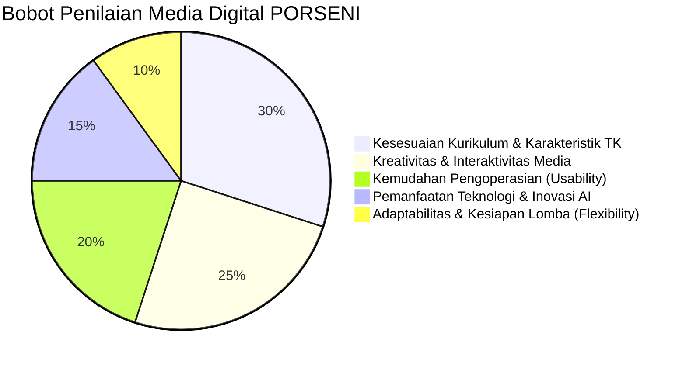

# Regulasi Lomba & Rubrik Penilaian Juri (Competition Rules)
> **PORSENI XV IGTKI-PGRI Jawa Timur — Kategori Karya Inovasi Media Pembelajaran Digital**  
> **Karya:** MISI CILIK: Selamatkan Lingkungan!

---

## 1. Profil Kompetisi & Sasaran Penilaian

Dalam ajang PORSENI IGTKI-PGRI, pembuatan media pembelajaran digital dinilai berdasarkan relevansi terhadap dunia pendidikan anak usia dini (PAUD), orisinalitas ide, diferensiasi jenjang usia, tujuan pembelajaran terukur, kemudahan implementasi oleh guru di kelas, serta pemanfaatan teknologi mutakhir (termasuk kecerdasan buatan / AI).



---

## 2. Matriks Rubrik Penilaian Dewan Juri

| No | Indikator Penilaian | Kriteria Unggul (Skor Maksimal) | Bukti Nyata dalam Aplikasi MISI CILIK |
| :---: | :--- | :--- | :--- |
| **1** | **Kesesuaian Kurikulum Merdeka & TP Terukur** | Memenuhi Capaian Pembelajaran (CP), memiliki Tujuan Pembelajaran (TP) terukur per misi, dan menerapkan **Diferensiasi Fase Fondasi (Kelompok A 4–5 Thn vs Kelompok B 5–6 Thn)** secara nyata. | Pilihan kelompok usia membedakan materi secara substansial (4 item sampah vs 6 item ilmiah; membilang 1–5 vs 1–10 mandiri; kartu bernomor vs konsep siklus; 2 vs 3 aksi gotong royong). |
| **2** | **Karakteristik Ramah Anak & Ergonomi TK** | Desain visual cerah, kontras tinggi, navigasi intuitif tanpa perlu membaca teks rumit, serta memiliki **Pemisahan Mode Antarmuka (Mode Anak vs Mode Guru)**. | Mode Anak bersih tanpa distraksi teks teknis, tombol raksasa ($\ge 72\text{px}$), sistem 2-klik proyektor sentuh, dan umpan balik suara TTS bersahabat. |
| **3** | **Interaktivitas & Keterlibatan Anak** | Media menuntut anak aktif (*learning by doing*), menghitung mandiri tanpa bocoran angka, serta menghubungkan dunia digital ke aksi nyata. | Mekanisme 2-klik pilah sampah, berhitung sentuh objek lingkungan mandiri, susun urutan sains, checklist gotong royong, dan kamera cermin aksi. |
| **4** | **Asesmen Autentik Berbasis Bukti Pengamatan** | Evaluasi anak tidak dibuat otomatis buta, melainkan memberikan instrumen bagi guru untuk mencatat bukti observasi perilaku riil. | Lembar evaluasi guru di Tahap 5 menyediakan pilihan skala capaian (BB, MB, BSH, BSB) interaktif dan otomatis tersimpan ke **Local Storage** untuk portofolio kelas. |
| **5** | **Kepraktisan di Kelas (Zero Setup)** | Media dapat dijalankan di laptop sekolah mana pun tanpa instalasi rumit, tanpa koneksi internet, dan tanpa risiko crash. | Format berkas tunggal `index.html`, *offline-first*, Web Audio sintetis prosedural tanpa membutuhkan berkas MP3 eksternal. |
| **6** | **Kesiapan Menghadapi Tema Dadakan** | Guru dapat menyesuaikan tema materi lomba dalam hitungan detik di depan dewan juri. | Fitur *Live Theme Switcher* dengan 4 sub-tema lengkap (Taman Ceria, Pantai & Laut, Kebun Binatang, Kelasku). |

---

## 3. Justifikasi Pemanfaatan Kecerdasan Buatan (AI Integration)

Untuk dipresentasikan kepada dewan juri, integrasi AI dalam proyek ini terbagi menjadi 3 pilar:

### Pilar 1: AI Speech Synthesis (Suara Edukatif Otomatis)
* **Teknologi:** Web Speech API (`window.speechSynthesis`).
* **Manfaat Pedagogis:** Membimbing anak TK yang belum lancar membaca melalui suara ceria, intonasi bersahabat (*pitch: 1.25, rate: 0.9*), serta umpan balik penguatan positif seketika.
* **Keunggulan Teknis:** Berjalan langsung di peramban tanpa kuota API eksternal dan bebas hambatan sinyal internet.

### Pilar 2: AI Config-Driven Generative Content & Video Panggung
* **Teknologi:** Arsitektur Objek `GAME_CONFIG` dan video animasi AI per sub-tema.
* **Manfaat Lomba:** Menjawab tantangan sistem lomba di mana juri dapat mengumumkan tema atau sub-tema secara mendadak.
* **Keunggulan Teknis:** Konsep *prompt-ready architecture* memungkinkan konfigurasi baru disuntikkan secara instan lengkap dengan video latar sub-tema yang relevan.

### Pilar 3: Asistensi Asesmen Autentik & Portofolio Digital (Local Storage)
* **Teknologi:** Interactive Evidence-Based Observation Matrix di Tahap 5 & Engine Penyimpanan Lokal.
* **Manfaat Guru:** Memudahkan guru mendokumentasikan capaian perkembangan 6 aspek anak berdasarkan bukti pengamatan riil, mencetak sertifikat penghargaan, dan mengelola portofolio kelas tanpa beban administrasi kertas.

---

## 4. SOP Presentasi 5 Menit di Hadapan Dewan Juri (Panduan Mbak Ratih)

Skenario alur presentasi efektif selama 5 menit:

```
[Menit 1: Pembukaan & Diferensiasi] ──► [Menit 2-3: Gameplay Interaktif & Mode Anak]
                                                         │
                                                         ▼
[Menit 5: Pameran 4 Sub-Tema Dadakan] ◄── [Menit 4: Asesmen Berbasis Bukti & Portofolio]
```

1. **Menit 01 — Pembukaan, Tujuan Pembelajaran Terukur & Diferensiasi (1 Menit):**
   * Perkenalkan media: *"MISI CILIK: Selamatkan Lingkungan!"* sebagai media pembelajaran digital interaktif berbasis Kurikulum Merdeka Fase Fondasi.
   * Tunjukkan **Diferensiasi Pembelajaran**: pilih `🐥 Kelompok A (4–5 Tahun)` atau `🦉 Kelompok B (5–6 Tahun)`. Jelaskan bahwa materi disesuaikan secara substansial (bukan sekadar label).
   * Tunjukkan bahwa aplikasi dibuka langsung via *double-click* berkas `index.html` tanpa memerlukan internet.
2. **Menit 02–03 — Simulasi Gameplay Interaktif & Mode Anak (2 Menit):**
   * **Tahap 1:** Tunjukkan video cerita animasi AI, suara narasi TTS, dan pertanyaan pemantik diskusi guru.
   * **Tahap 2:** Demonstrasikan sistem 2-klik pilah sampah (ramah proyektor sentuh) dan tunjukkan kartu sampah Kelompok A (4 item konkret) vs Kelompok B (6 item dengan alasan ilmiah).
   * **Tahap 3:** Demonstrasikan berhitung mandiri tanpa bocoran angka dan penyesuaian nama objek sesuai tema (misal: bintang laut di pantai).
   * **Tahap 4:** Tunjukkan timer 60 detik gotong royong dan aktivasi kamera aksi nyata dengan izin pengguna.
3. **Menit 04 — Asesmen Berbasis Bukti Pengamatan & Sertifikat (1 Menit):**
   * Masuk ke Tahap 5, perlihatkan sertifikat digital terbit lengkap dengan badge kelompok, foto aksi anak, dan 5 Bintang Emas.
   * Buka lembar evaluasi guru: jelaskan bahwa **skala capaian (BB, MB, BSH, BSB) dipilih guru berdasarkan bukti nyata pengamatan** selama bermain, bukan otomatis buta.
   * Buka Panel Juri Tab 3 ("📊 Data Hasil Murid"): perlihatkan portofolio kelas yang tersimpan rapi di Local Storage dan dapat dicetak ulang.
4. **Menit 05 — Pameran Fleksibilitas Tema Dadakan (1 Menit):**
   * Buka Panel Juri Tab 2: `"🎨 Ubah Tema Cepat"`.
   * Klik salah satu preset (misal: *Pantai & Laut Bersih* atau *Kebun Binatang*). Tunjukkan bahwa dalam 1 detik seluruh tampilan, narasi, video latar, maskot, sampah, dan objek hitung berganti secara harmonis tanpa membuka baris kode baru.

---

## 5. Checklist Pengujian Menyeluruh Menjelang Lomba (Pre-Competition Checklist)

Sebelum tampil di panggung lomba, pastikan seluruh item berikut telah diuji pada laptop yang akan digunakan:

- [ ] **Video Cerita Animasi:** Seluruh 4 video (`cerita_taman.mp4`, `cerita_pantai.mp4`, `cerita_zoo.mp4`, `cerita_kelas.mp4`) dapat diputar lancar tanpa lag.
- [ ] **Narasi Suara (Web Speech API):** Suara narasi Bahasa Indonesia terdengar jernih dan tombol kontrol audio (`🔊` dan `🎵`) berfungsi baik.
- [ ] **Pilah Sampah 2-Klik:** Respon klik-sampah lalu klik-tong berjalan mulus pada mouse maupun layar sentuh.
- [ ] **Diferensiasi Sampah A & B:** Kelompok A menampilkan 4 item konkret, Kelompok B menampilkan 6 item berargumen ilmiah.
- [ ] **Penghitungan Numerasi:** Objek hitung sesuai tema (bunga/bintang laut/hewan/peralatan) dan narasi instruksi bebas bocoran angka.
- [ ] **Urutan Sains:** Kartu urutan siklus 1–4 dapat disusun dengan feedback visual yang benar.
- [ ] **Timer Aksi Nyata:** Jam hitung mundur 60 detik dapat dimulai, dijeda, dan dilewati.
- [ ] **Kamera Bukti Aksi:** Berfungsi dengan izin pengguna (*permission prompt*) dan memiliki *safe fallback* avatar jika kamera tidak tersedia.
- [ ] **Sertifikat & Cetak:** Tombol cetak membuka jendela print yang bersih dan rapi (*clean print stylesheet*).
- [ ] **Asesmen Guru & Local Storage:** Predikat BB-BSB dapat diklik guru dan data murid tersimpan di Tab 3 Panel Juri.
- [ ] **Live Theme Switcher:** Pergantian ke 4 tema dadakan berjalan instan (<0.5 detik).
