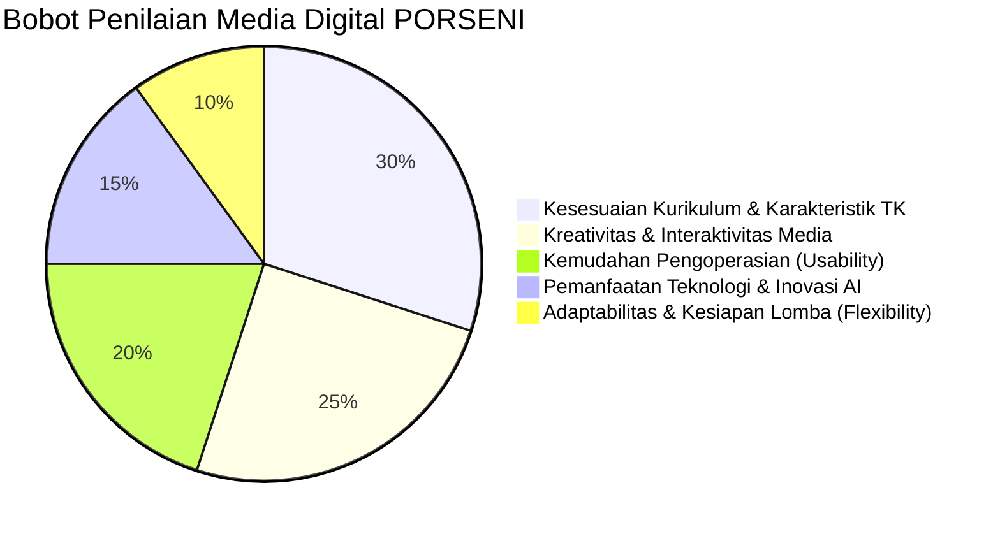

# Regulasi Lomba & Rubrik Penilaian Juri (Competition Rules)
> **PORSENI XV IGTKI-PGRI Jawa Timur — Kategori Karya Inovasi Media Pembelajaran Digital**  
> **Karya:** MISI CILIK: Selamatkan Lingkungan!

---

## 1. Profil Kompetisi & Sasaran Penilaian

Dalam ajang PORSENI IGTKI-PGRI, pembuatan media pembelajaran digital dinilai berdasarkan relevansi terhadap dunia pendidikan anak usia dini (PAUD), orisinalitas ide, diferensiasi jenjang usia, kemudahan implementasi oleh guru di kelas, serta pemanfaatan teknologi mutakhir (termasuk kecerdasan buatan / AI).

---

## 2. Matriks Rubrik Penilaian Dewan Juri

| No | Indikator Penilaian | Kriteria Unggul (Skor Maksimal) | Bukti Nyata dalam Aplikasi MISI CILIK |
| :---: | :--- | :--- | :--- |
| **1** | **Kesesuaian Kurikulum Merdeka** | Memenuhi Capaian Pembelajaran (CP), mencakup 6 aspek perkembangan anak usia dini, dan menyediakan **Diferensiasi Pembelajaran (Kelompok A 4–5 Thn vs Kelompok B 5–6 Thn)** secara nyata. | Pilihan kelompok usia di awal mengatur kompleksitas misi (1–5 vs 1–10, nomor urut vs mandiri, 2 vs 3 checklist aksi) dan rubrik evaluasi dinamis. |
| **2** | **Karakteristik Ramah Anak TK** | Desain visual cerah, kontras tinggi, navigasi intuitif tanpa perlu membaca teks rumit, serta umpan balik suara menyenangkan. | Tombol raksasa membulat (`rounded-3xl`), animasi CSS lembut, panduan suara narasi TTS di setiap langkah. |
| **3** | **Interaktivitas & Keterlibatan Anak** | Media tidak pasif (bukan sekadar menonton video), melainkan menuntut anak berbuat (*learning by doing*). | Mekanisme 2-klik pilah sampah, berhitung sentuh bunga, susun urutan sains, dan kamera aksi nyata. |
| **4** | **Inovasi Pemanfaatan AI & Portofolio** | Pemanfaatan AI tepat guna, terarah, dan memiliki sistem rekapitulasi data hasil asesmen murid yang rapi. | AI Voice TTS Bahasa Indonesia ramah anak, arsitektur *AI Generative Config*, dan penyimpanan otomatis portofolio murid di **Local Storage**. |
| **5** | **Kepraktisan di Kelas (Zero Setup)** | Media dapat dijalankan di laptop sekolah mana pun tanpa instalasi rumit, tanpa internet kencang, dan tanpa crash. | Format tunggal `index.html`, *offline-first*, Web Audio sintetis prosedural tanpa butuh file MP3 eksternal. |
| **6** | **Kesiapan Menghadapi Tema Dadakan** | Guru dapat menyesuaikan tema materi lomba dalam hitungan detik di depan dewan juri. | Fitur *Live Theme Switcher* dengan 4 sub-tema lengkap (Taman Ceria, Pantai & Laut, Kebun Binatang, Kelasku). |

---

## 3. Justifikasi Pemanfaatan Kecerdasan Buatan (AI Integration)

Untuk dipresentasikan kepada dewan juri, integrasi AI dalam proyek ini terbagi menjadi 3 pilar:

### Pilar 1: AI Speech Synthesis (Suara Edukatif Otomatis)
* **Teknologi:** Web Speech API (`window.speechSynthesis`).
* **Manfaat Pedagogis:** Anak TK belum lancar membaca tulisan. AI bertindak sebagai pemandu suara ceria yang membacakan setiap narasi cerita, instruksi misi, dan ucapan selamat secara interaktif.
* **Keunggulan Teknis:** Berjalan langsung di peramban tanpa kuota API eksternal dan dapat menyesuaikan laju bicara (*rate* 0.9x) serta nada (*pitch* 1.25x) agar terdengar ramah seperti guru TK.

### Pilar 2: AI Config-Driven Generative Content & Video Panggung
* **Teknologi:** Arsitektur Objek `GAME_CONFIG` dan video animasi AI.
* **Manfaat Lomba:** Menjawab tantangan sistem lomba di mana juri dapat mengumumkan tema atau sub-tema secara mendadak (misal: "Tema Air, Udara, Api" atau "Tema Binatang Ternak").
* **Keunggulan Teknis:** Konsep *prompt-ready architecture* memungkinkan prompt AI menghasilkan konfigurasi baru seketika lengkap dengan video latar sub-tema yang relevan.

### Pilar 3: Asistensi Evaluasi Autentik & Portofolio Digital (Local Storage)
* **Teknologi:** Smart Observation Matrix di Tahap 5 & Engine Penyimpanan Lokal.
* **Manfaat Guru:** Mengonversi data interaksi anak selama bermain game (ketepatan memilah, kecepatan berhitung, foto aksi) menjadi lembar laporan capaian perkembangan siap cetak serta menyimpannya ke tabel rekap portofolio kelas.

---

## 4. SOP Presentasi 5 Menit di Hadapan Dewan Juri

Jika peserta memiliki waktu terbatas (5 menit) untuk mempresentasikan media di hadapan juri:

1. **Menit 01 — Pembukaan, Diferensiasi Usia & Latar Belakang (1 Menit):**
   * Perkenalkan media: *"MISI CILIK: Selamatkan Lingkungan!"* sebagai jembatan inovatif kurikulum digital ke aksi nyata anak TK.
   * Tunjukkan fitur diferensiasi usia: pilih `🐥 Kelompok A (4–5 Tahun)` atau `🦉 Kelompok B (5–6 Tahun)` dan masukkan nama anak.
   * Tunjukkan bahwa aplikasi langsung dibuka melalui *double-click* berkas `index.html` tanpa internet.
2. **Menit 02–03 — Simulasi Gameplay Interaktif (2 Menit):**
   * Jalankan Tahap 1 (suara TTS menyala, tunjukkan pertanyaan pemantik yang menyesuaikan kelompok usia).
   * Tunjukkan Tahap 2: demonstrasikan sistem 2-klik pilah sampah dan alasan edukatif (Kelompok B).
   * Tunjukkan Tahap 3: demonstrasikan membilang bunga interaktif (1–5 atau 1–10) dan urutan sains.
   * Tunjukkan Tahap 4: demonstrasikan aktivasi kamera webcam anak beraksi langsung di layar.
3. **Menit 04 — Pembuktian Kurikulum, Sertifikat & Rekap Data Murid (1 Menit):**
   * Masuk ke Tahap 5, perlihatkan sertifikat digital terbit lengkap dengan badge kelompok, foto anak, dan 5 Bintang.
   * Tunjukkan tabel rubrik evaluasi guru yang indikatornya otomatis berganti sesuai kelompok A/B.
   * Buka panel juri Tab 3 ("📊 Data Hasil Murid"): perlihatkan bahwa data anak langsung tersimpan, bisa dicetak ulang, atau dihapus.
4. **Menit 05 — Pameran Fleksibilitas Tema Dadakan (1 Menit):**
   * Buka panel juri Tab 2: `"🎨 Ubah Tema Cepat"`.
   * Klik salah satu preset (misal: *Pantai & Laut Bersih*). Tunjukkan bahwa dalam 1 detik seluruh tampilan, narasi, video, maskot, dan sampah berganti menjadi biota laut tanpa menulis kode baru.
