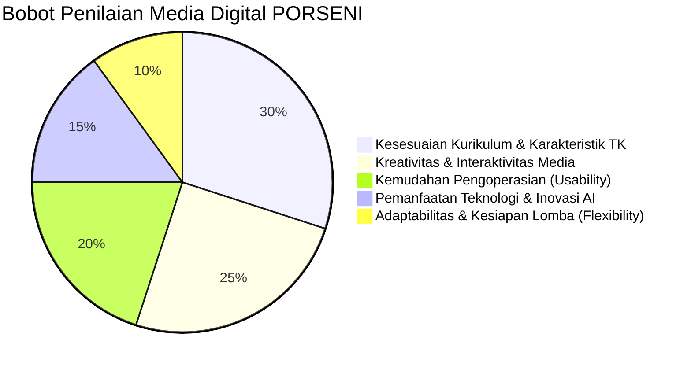

# Regulasi Lomba & Rubrik Penilaian Juri (Competition Rules)
> **PORSENI XV IGTKI-PGRI Jawa Timur — Kategori Karya Inovasi Media Pembelajaran Digital**

---

## 1. Profil Kompetisi & Sasaran Penilaian

Dalam ajang PORSENI IGTKI-PGRI, pembuatan media pembelajaran digital dinilai berdasarkan relevansi terhadap dunia pendidikan anak usia dini (PAUD), orisinalitas ide, kemudahan implementasi oleh guru di kelas, serta pemanfaatan teknologi mutakhir (termasuk kecerdasan buatan / AI).

---

## 2. Matriks Rubrik Penilaian Dewan Juri

| No | Indikator Penilaian | Kriteria Unggul (Skor Maksimal) | Bukti Nyata dalam Aplikasi MISI CILIK |
| :---: | :--- | :--- | :--- |
| **1** | **Kesesuaian Kurikulum Merdeka** | Memenuhi Capaian Pembelajaran (CP) dan mencakup 6 aspek perkembangan anak usia dini secara terpadu. | Panel Juri memuat pemetaan CP, TP, dan rubrik evaluasi autentik 6 aspek perkembangan. |
| **2** | **Karakteristik Ramah Anak TK** | Desain visual cerah, kontras tinggi, navigasi intuitif tanpa perlu membaca teks rumit, serta umpan balik suara menyenangkan. | Tombol raksasa membulat (`rounded-3xl`), animasi CSS lembut, panduan suara narasi TTS di setiap langkah. |
| **3** | **Interaktivitas & Keterlibatan Anak** | Media tidak pasif (bukan sekadar menonton video), melainkan menuntut anak berbuat (*learning by doing*). | Mekanisme 2-klik pilah sampah, berhitung sentuh bunga, susun urutan, dan kamera aksi nyata. |
| **4** | **Inovasi Pemanfaatan AI** | Pemanfaatan AI tepat guna, terarah, dan dapat dijelaskan secara pedagogis serta teknis. | AI Voice TTS Bahasa Indonesia ramah anak, arsitektur *AI Generative Config*, dan alat bantu rubrik. |
| **5** | **Kepraktisan di Kelas (Zero Setup)** | Media dapat dijalankan di laptop sekolah mana pun tanpa instalasi rumit, tanpa internet kencang, dan tanpa crash. | Format tunggal `index.html`, *offline-first*, Web Audio sintetis prosedural tanpa butuh file MP3 eksternal. |
| **6** | **Kesiapan Menghadapi Tema Dadakan** | Guru dapat menyesuaikan tema materi lomba dalam hitungan menit di depan juri. | Fitur *Live Theme Switcher* dengan 4 preset lengkap (Taman, Pantai, Kebun Binatang, Kelas). |

---

## 3. Justifikasi Pemanfaatan Kecerdasan Buatan (AI Integration)

Untuk dipresentasikan kepada dewan juri, integrasi AI dalam proyek ini terbagi menjadi 3 pilar:

### Pilar 1: AI Speech Synthesis (Suara Edukatif Otomatis)
* **Teknologi:** Web Speech API (`window.speechSynthesis`).
* **Manfaat Pedagogis:** Anak TK belum lancar membaca tulisan. AI bertindak sebagai pemandu suara ceria yang membacakan setiap narasi cerita, instruksi misi, dan ucapan selamat secara interaktif.
* **Keunggulan Teknis:** Berjalan langsung di peramban tanpa kuota API eksternal dan dapat menyesuaikan laju bicara (*rate* 0.9x) serta nada (*pitch* 1.2x) agar terdengar ramah seperti guru TK.

### Pilar 2: AI Config-Driven Generative Content
* **Teknologi:** Arsitektur Objek `GAME_CONFIG`.
* **Manfaat Lomba:** Menjawab tantangan sistem lomba di mana juri dapat mengumumkan tema atau sub-tema secara mendadak (misal: "Tema Air, Udara, Api" atau "Tema Binatang Ternak").
* **Keunggulan Teknis:** Konsep *prompt-ready architecture* memungkinkan prompt AI menghasilkan struktur data konfigurasi baru secara instan untuk disuntikkan ke dalam aplikasi.

### Pilar 3: Asistensi Evaluasi Perkembangan Autentik
* **Teknologi:** Smart Observation Matrix di Tahap 5.
* **Manfaat Guru:** Mengonversi data interaksi anak selama bermain game (ketepatan memilah, kecepatan berhitung, foto aksi) menjadi lembar laporan capaian perkembangan siap cetak.

---

## 4. SOP Presentasi 5 Menit di Hadapan Dewan Juri

Jika peserta memiliki waktu terbatas (5 menit) untuk mempresentasikan media di hadapan juri:

1. **Menit 01 — Pembukaan & Latar Belakang Masalah (1 Menit):**
   * Perkenalkan media: *"MISI CILIK: Selamatkan Taman Ceria"* sebagai jembatan pembelajaran digital ke aksi nyata anak TK.
   * Tunjukkan bahwa aplikasi langsung dibuka melalui *double-click* berkas `index.html` (bebas kendala sinyal).
2. **Menit 02–03 — Simulasi Gameplay Interaktif (2 Menit):**
   * Jalankan Tahap 1 (suara TTS menyala, diskusi pemantik).
   * Tunjukkan Tahap 2: sistem 2-klik pilah sampah (mudah untuk proyektor/layar sentuh).
   * Tunjukkan Tahap 4: demonstrasikan aktivasi kamera webcam anak beraksi langsung di layar.
3. **Menit 04 — Pembuktian Kurikulum & Aspek Perkembangan (1 Menit):**
   * Masuk ke Tahap 5, perlihatkan sertifikat digital terbit lengkap dengan foto anak dan perolehan 5 Bintang.
   * Buka tabel rubrik penilaian guru untuk 6 aspek perkembangan.
4. **Menit 05 — Pameran Fleksibilitas Tema Dadakan (1 Menit):**
   * Buka panel pojok kanan atas: `"📋 Panel Juri & Editor Tema"`.
   * Klik salah satu preset (misal: *Pantai & Laut Bersih*). Tunjukkan bahwa dalam 1 detik seluruh tampilan, narasi, maskot, dan sampah berganti menjadi biota laut tanpa menulis kode baru.
