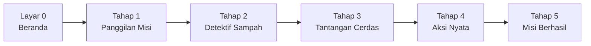

# Aturan & Mekanisme Permainan (Game Rules)
> **MISI CILIK: Selamatkan Taman Ceria!**  
> Standar interaksi, validasi jawaban, state layar, dan sistem penghargaan bintang.

---

## 1. Ikhtisar Alur Permainan

Permainan terdiri dari **1 Layar Utama (Home)** dan **5 Tahap Misi Edukatif** berurutan. Setiap tahap dirancang untuk melatih aspek perkembangan anak usia 4–6 tahun dengan umpan balik visual dan audio instan.

---

## 2. Aturan Layar & Gameplay Tiap State

### Layar 0: Beranda (Home Screen)
* **Tujuan:** Menarik minat anak, memperkenalkan maskot (*Ara si Lebah*), dan memberi akses pengaturan bagi guru.
* **Elemen Interaktif:**
  * Tombol Raksasa: `"🚀 MULAI MISI SEKARANG!"` → memicu transisi ke Tahap 1, memutar SFX Pop, dan menyalakan musik latar.
  * Tombol Sekunder: `"⚙️ Ubah Tema Cepat (Mode Lomba)"` → membuka modal pergantian tema tanpa membuka kode.
  * Tombol Bantuan/Header: Kontrol audio narasi (`🔊`), kontrol musik (`🎵`), dan panel juri (`📋`).

---

### Layar 1: Tahap 1 — Panggilan Misi (Observasi & Bahasa)
* **Tujuan Pembelajaran:** Melatih kemampuan mengamati masalah lingkungan dan berani mengungkapkan pendapat secara lisan.
* **Mekanisme Permainan:**
  1. Anak menyaksikan ilustrasi/animasi taman kotor (tanaman layu, sampah berserakan, awan kelabu).
  2. Guru menekan tombol `"▶️ Putar Cerita Animasi"` untuk memicu narasi suara TTS otomatis.
  3. Guru mengajukan 3 pertanyaan pemantik diskusi yang tertera pada kartu panduan.
  4. Ketika anak di kelas memberikan respon/pendapat, guru menekan tombol:
     * `"🗣️ Anak Sudah Berpendapat (+1 ⭐)"`
  5. Sistem memutar efek suara tepuk tangan meriah, menambah 1 bintang ke bar header, dan mengaktifkan tombol `"Lanjut ke Tahap 2 ➔"`.

---

### Layar 2: Tahap 2 — Misi Detektif Sampah (Kognitif & Motorik)
* **Tujuan Pembelajaran:** Mengklasifikasikan sampah organik vs. anorganik serta memahami kebutuhan air bagi tanaman.
* **Target Item:** 6 Sampah (3 Organik: Pisang, Daun, Apel; 3 Anorganik: Botol Plastik, Kaleng, Kantong Kresek).
* **Target Wadah:**
  * **Tong Hijau:** Sampah Organik (Sisa Makanan, Daun Kering).
  * **Tong Kuning:** Sampah Anorganik (Plastik, Kaleng, Kresek).
* **Mekanisme Input Ganda (Dual-Input UX):**
  1. **Mode 2-Klik (Sangat Direkomendasikan untuk Layar Sentuh & Proyektor TK):**
     * Klik 1: Anak menyentuh item sampah → sampah diberi efek lingkaran berpendar (*glow effect*).
     * Klik 2: Anak menyentuh tong sampah tujuan (Hijau / Kuning).
  2. **Mode Drag-and-Drop:**
     * Anak menyeret item sampah ke dalam tong sampah tujuan.
* **Aturan Validasi & Umpan Balik:**
  * **Jika Benar:**
    * SFX *Ting/Chime* ceria dimainkan.
    * Sampah mengecil dan menghilang masuk ke dalam tong.
    * Animasi partikel bintang terbang menuju tong sampah.
    * Suara TTS otomatis: *"Hebat! Itu sampah [organik/anorganik]!"*.
  * **Jika Salah:**
    * SFX *Tetot/Buzzer* lembut berbunyi.
    * Tong sampah bergetar pelan (*shake animation*).
    * Sampah kembali ke posisi semula.
    * Suara TTS otomatis: *"Ups, coba perhatikan lagi ya!"*.
* **Mini-Kuis Menyiram Tanaman:**
  * Muncul setelah keenam sampah berhasil dipilah.
  * Pertanyaan: *"Tanaman masih haus! Pilih benda untuk menyiram tanaman:"*
  * Pilihan: `🚿 Penyiram Air` (Benar) | `🔥 Api` (Salah) | `🪨 Batu` (Salah).
  * Jawaban benar membuka tombol `"Lanjut ke Tahap 3 ➔"` dan memberikan **+1 ⭐**.

---

### Layar 3: Tahap 3 — Tantangan Cerdas (Numerasi & Kognitif)
Terdiri dari 2 sub-tantangan bergantian secara seamless:

#### Sub-Tantangan 3A: Berhitung Bunga Mekar (Numerasi)
* **Aturan:**
  * Di taman bermunculan bunga-bunga matahari (`🌻`).
  * Anak diajak menyentuh bunga satu per satu. Setiap bunga yang disentuh memunculkan label angka berurutan (`1, 2, 3, 4, 5`) dan sistem mengucapkan angka tersebut via TTS (`"Satu!"`, `"Dua!"`, dst.).
  * Setelah selesai membilang, anak memilih kartu jawaban jumlah: `[3]`, `[4]`, `[5]`.
  * Memilih kartu `[5]` memicu suara hore dan membuka Sub-Tantangan 3B.

#### Sub-Tantangan 3B: Mengurutkan Pertumbuhan Tanaman (Sains)
* **Aturan:**
  * Disediakan 4 kartu fase yang diacak:
    1. `🌰 Tanam Biji`
    2. `🌱 Tumbuh Tunas`
    3. `🚿 Siram Air`
    4. `🌷 Bunga Mekar`
  * Anak menyentuh kartu sesuai urutan pertumbuhan dari awal hingga berbunga.
  * Kartu yang dipilih dengan benar akan berpindah ke slot urutan `1 → 2 → 3 → 4`.
  * Jika salah urutan, kartu bergetar dan anak dipersilakan memilih kartu yang tepat.
  * Setelah lengkap ke-4 urutan, sistem memberikan reward **+1 ⭐** dan membuka `"Lanjut ke Tahap 4 ➔"`.

---

### Layar 4: Tahap 4 — Aksi Nyata Penyelamat Lingkungan (Sosial-Emosional & Motorik Kasar)
* **Tujuan Pembelajaran:** Menghubungkan dunia digital ke perilaku nyata sehari-hari di ruang kelas atau sekolah.
* **Mekanisme Permainan:**
  * **Hitung Mundur Waktu (Timer 60 Detik):** Jam hitung mundur besar dengan tombol `Mulai`, `Jeda`, dan `Lewati (Skip)` untuk memandu ritme aktivitas fisik anak di kelas.
  * **Daftar Checklist Aksi:** Guru/Anak mencentang 3 aktivitas:
    * `☑️ Mengambil sampah di sekitar dan membuang ke tempatnya`
    * `☑️ Menyiram tanaman di taman sekolah dengan tertib`
    * `☑️ Bergantian dan bekerja sama dengan teman`
  * **Kamera Bukti Aksi (`getUserMedia`):**
    * Tombol `"📸 Buka Kamera & Foto Aksi Anak"` mengaktifkan webcam laptop.
    * Menampilkan video langsung (*live feed*) di layar proyektor sehingga anak-anak melihat diri mereka sendiri.
    * Tombol `"Ambil Foto"` menangkap gambar anak yang memegang alat peraga/sampah.
    * Jika kamera tidak diizinkan atau tidak tersedia, sistem menyediakan gambar ilustrasi avatar anak secara otomatis (*safe fallback*).
  * Menyelesaikan tahap ini memberikan **+1 ⭐** dan membuka pintu ke Tahap 5.

---

### Layar 5: Tahap 5 — Misi Berhasil & Penilaian Akhir
* **Tujuan Pembelajaran:** Memberikan apresiasi prestasi belajar anak, refleksi perasaan, dan instrumen penilaian autentik guru.
* **Mekanisme Tampilan:**
  * **Hujan Confetti:** Partikel warna-warni bertebaran merayakan kemenangan.
  * **Transformasi Before-After:** Animasi transisi visual taman yang kotor menjadi taman yang asri, hijau, dengan bunga mekar dan pelangi.
  * **Sertifikat Digital Penghargaan:**
    * Berisi nama maskot, gelar *"Penyelamat Taman Cilik"*, foto hasil jepretan Tahap 4, dan **5 Bintang Emas Penuh (⭐⭐⭐⭐⭐)**.
  * **Lembar Evaluasi Guru Cepat:**
    * Tabel checklist 6 aspek perkembangan (NAM, Kognitif, Bahasa, Sosek, Motorik, Digital).
    * Tombol `"🖨️ Cetak / Simpan Sertifikat & Evaluasi"`.
  * **Tombol Restart:** `"🔄 Main Lagi dari Awal"` untuk mengulang pembelajaran kelompok berikutnya.

---

## 3. Sistem Bintang & Skoring (Scoring Logic)

Total Bintang Maksimal: **5 Bintang Emas (`⭐⭐⭐⭐⭐`)**

| Tahap | Aktivitas Pemicu Bintang | Skor |
| :---: | :--- | :---: |
| **Tahap 1** | Anak aktif berpendapat dalam diskusi pemantik guru | `+1 ⭐` |
| **Tahap 2** | Berhasil memilah seluruh 6 sampah + memilih penyiram air | `+1 ⭐` |
| **Tahap 3** | Menyelesaikan kuis hitung bunga & urutan tanaman | `+1 ⭐` |
| **Tahap 4** | Mempraktikkan checklist aksi nyata & foto bersama | `+1 ⭐` |
| **Tahap 5** | Bonus penyelesaian misi paripurna | `+1 ⭐` |
| **Total** | **Gelar: Penyelamat Lingkungan Cilik Teladan** | **5 ⭐** |
