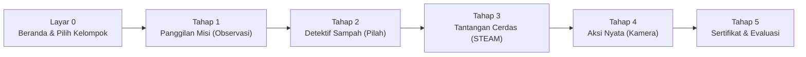

# Aturan & Mekanisme Permainan (Game Rules)
> **MISI CILIK: Selamatkan Lingkungan!**  
> Standar interaksi, diferensiasi Kelompok A & B, validasi jawaban, state layar, dan sistem penghargaan bintang.

---

## 1. Ikhtisar Alur Permainan & Hierarki Judul

Permainan mengadopsi struktur judul bertingkat untuk mengakomodasi berbagai sub-tema lingkungan hidup:
* **Judul Payung Utama:** `MISI CILIK: SELAMATKAN LINGKUNGAN!`
* **Judul Sub-Tema Aktif Dinamis:** Berganti otomatis saat tema dipilih:
  * Tema 1: `SELAMATKAN TAMAN CERIA!` (Taman Bunga Asri)
  * Tema 2: `SELAMATKAN PANTAI & LAUT!` (Ekosistem Pesisir & Biota Laut)
  * Tema 3: `SELAMATKAN KEBUN BINATANG!` (Kandang Hewan & Satwa Liar)
  * Tema 4: `SELAMATKAN KELASKU!` (Ruang Kelas Bersih & Rapi)

Permainan terdiri dari **1 Layar Utama (Home)** dan **5 Tahap Misi Edukatif** berurutan. Setiap tahap dirancang dengan prinsip **Diferensiasi Fase Fondasi** untuk mengakomodasi anak usia 4–5 tahun (Kelompok A) dan usia 5–6 tahun (Kelompok B).

---

## 2. Aturan Layar & Gameplay Tiap State

### Layar 0: Beranda (Home Screen) & Seleksi Kelompok Usia
* **Tujuan:** Menarik minat anak, memperkenalkan maskot aktif (*Ara si Lebah*), memilih kelompok jenjang usia, dan memasukkan identitas murid.
* **Elemen Interaktif:**
  * **Selektor Kelompok Usia (Diferensiasi Pembelajaran):**
    * `🐥 Kelompok A (Usia 4–5 Tahun)`: Misi bertahap, panduan visual nyata, membilang angka 1–5.
    * `🦉 Kelompok B (Usia 5–6 Tahun)`: Misi mandiri analitis, pemahaman sebab-akibat, membilang angka 1–10.
  * **Input Nama Murid:** Kotak input nama panggilan anak yang akan disematkan pada sertifikat penghargaan dan lembar evaluasi guru.
  * **Panggung Video Animasi:** Video animasi AI (`cerita_taman.mp4`) yang otomatis berganti sesuai sub-tema aktif.
  * **Tombol Raksasa:** `"🚀 MULAI MISI SEKARANG!"` → memvalidasi kelompok, membuka kunci audio, dan berpindah ke Tahap 1.
  * **Panel Pengaturan Guru/Juri:** Akses ke Tab Profil Media, Tab Preset Tema Cepat, dan Tab Data Hasil Murid (Local Storage).

---

### Layar 1: Tahap 1 — Panggilan Misi (Observasi & Bahasa)
* **Tujuan Pembelajaran:** Melatih kepekaan mengamati kondisi lingkungan dan berani menyampaikan pendapat secara verbal.
* **Mekanisme Permainan:**
  1. Anak menyaksikan visual lingkungan yang membutuhkan bantuan (sampah berantakan, tanaman layu).
  2. Tombol `"▶️ Putar Cerita Animasi"` mengaktifkan narasi suara TTS maskot secara otomatis.
  3. Guru memandu diskusi menggunakan 3 pertanyaan pemantik yang **berbeda sesuai kelompok usia**:
     * **Kelompok A (Fokus Observasi Konkret):**
       1. *"Anak-anak pintar, apa saja benda yang membuat tempat ini jadi kotor?"*
       2. *"Kira-kira apa yang dirasakan tanaman jika kekurangan air?"*
       3. *"Siapa anak hebat yang mau ikut membantu Ara merawat tempat ini?"*
     * **Kelompok B (Fokus Analisis Sebab-Akibat & Solusi):**
       1. *"Menurut teman-teman, mengapa sampah bisa menumpuk di tempat ini?"*
       2. *"Apa bahayanya bagi lingkungan dan hewan jika sampah dibiarkan berhari-hari?"*
       3. *"Bagaimana cara kita mengajak orang lain agar tidak membuang sampah sembarangan?"*
  4. Ketika anak merespons, guru menekan tombol `"🗣️ Anak Sudah Berpendapat (+1 ⭐)"`.
  5. Sistem memutar SFX tepuk tangan meriah, menambah 1 bintang, dan membuka tombol `"Lanjut ke Misi Detektif ➔"`.
  6. **Navigasi Mundur & Sinkronisasi Visual**:
     * Layar 1 dilengkapi tombol navigasi `"⬅ Kembali"` menuju Beranda (Layar 0).
     * Ikon skenario dan kondisi visual berganti dinamis 100% mengikuti sub-tema aktif (Pantai: `🌊`, Zoo: `🦁`, Kelas: `🎒`, Taman: `🥀`).
     * Tombol suara narasi menyesuaikan nama maskot tema aktif (contoh: *"Dengarkan Cerita Lulu Lumba-lumba"*).

---

### Layar 2: Tahap 2 — Misi Detektif Sampah (Kognitif & Motorik)
* **Tujuan Pembelajaran:** Mengklasifikasikan sampah organik vs. anorganik serta menumbuhkan kesadaran pemeliharaan tanaman/lingkungan.
* **Target Item:** 6 Sampah (3 Organik dan 3 Anorganik sesuai sub-tema aktif).
* **Target Wadah:**
  * **Tong Hijau:** Sampah Organik (Mudah membusuk, daun kering, sisa buah/makanan).
  * **Tong Kuning:** Sampah Anorganik (Plastik, kaleng, bungkus kemasan buatan pabrik).
* **Mekanisme Input Ganda (Dual-Input UX):**
  1. **Mode 2-Klik (Click-to-Select, Click-to-Drop):** Solusi ideal layar proyektor sentuh TK.
     * Klik 1: Sentuh sampah → sampah berpendar emas (*glow effect*) dan mengeluarkan nada pop.
     * Klik 2: Sentuh tong tujuan → sampah meluncur masuk ke dalam tong.
  2. **Mode Drag-and-Drop:** Alternatif seret-lepas dengan mouse komputer biasa.
* **Diferensiasi Kelompok A vs Kelompok B:**
  * **Kelompok A:** Panduan visual sederhana, instruksi ramah dan singkat.
  * **Kelompok B:** Dilengkapi badge **Alasan Edukatif Sebab-Akibat** pada setiap kartu sampah (contoh: *"Botol plastik butuh ratusan tahun untuk terurai"* atau *"Daun kering bisa diolah jadi pupuk kompos"*).
* **Aturan Umpan Balik (Zero Punishment Policy):**
  * **Benar:** SFX *Chime* gembira, animasi partikel bintang, sampah mengecil ke dalam tong, dan TTS memvalidasi jenis sampah.
  * **Salah:** SFX nada lembut pembinaan, tong bergetar pelan (*soft-shake*), sampah kembali ke tempat semula, dan TTS memberikan bimbingan konstruktif: *"Ayo perhatikan lagi, apakah benda ini mudah membusuk atau dari plastik/kaleng?"*.
* **Mini-Kuis Penyelamatan Lingkungan:**
  * Muncul otomatis setelah 6 sampah selesai dipilah.
  * Memilih alat bantu penyelamatan (misal: `🚿 Alat Siram Air` vs `🔥 Api` vs `🪨 Batu`).
  * Jawaban tepat memberikan **+1 ⭐** dan membuka akses ke Tahap 3.
* **Navigasi Mundur:** Dilengkapi tombol navigasi `⬅ Kembali` yang memungkinkan guru/anak kembali ke Tahap 1 untuk meninjau observasi awal.

---

### Layar 3: Tahap 3 — Tantangan Cerdas (Numerasi & Sains STEAM)
Terdiri dari 2 sub-tantangan berurutan:

#### Sub-Tantangan 3A: Berhitung Bilangan (Numerasi)
* **Diferensiasi Kelompok:**
  * **Kelompok A (Membilang 1–5):**
    * Menampilkan 5 objek bunga/hewan mekar (`🌻`).
    * Pilihan jawaban: `[3]`, `[4]`, `[5]`.
  * **Kelompok B (Membilang 1–10):**
    * Menampilkan 10 objek bunga/hewan mekar (`🌻`).
    * Pilihan jawaban adaptif: `[8]`, `[9]`, `[10]`.
* **Fitur Audio-Verbal Interaktif:** Setiap objek yang disentuh anak memunculkan label angka dan dibacakan urutannya oleh TTS (*"Satu!"*, *"Dua!"*, dst.) melatih prinsip korespondensi satu-satu.

#### Sub-Tantangan 3B: Mengurutkan Siklus Tumbuh / Metamorfosis (Sains)
* **Aturan Permainan:** Disediakan 4 kartu tahapan perkembangan alami (contoh pada Taman: *Biji → Tunas → Siram Air → Bunga Mekar*).
* **Diferensiasi Kelompok:**
  * **Kelompok A:** Kartu dilengkapi nomor urut eksplisit (`1. Tanam Biji`, `2. Tumbuh Tunas`, `3. Siram Air`, `4. Bunga Mekar`) sebagai petunjuk visual perancah (*scaffolding*).
  * **Kelompok B:** Kartu mandiri **tanpa nomor urut** (`Tanam Biji`, `Tumbuh Tunas`, `Siram Air`, `Bunga Mekar`). Saat selesai disusun, narasi TTS menguraikan sains sebab-akibat secara utuh (*"Hebat! Biji yang ditanam memerlukan air dan sinar matahari untuk bertunas hingga menjadi bunga mekar yang indah!"*).
* Menyelesaikan kedua sub-tantangan ini memberikan reward **+1 ⭐** dan membuka tombol ke Tahap 4.
* **Navigasi Mundur:** Dilengkapi tombol navigasi `⬅ Kembali` menuju Tahap 2.

---

### Layar 4: Tahap 4 — Aksi Nyata Penyelamat Lingkungan (Sosial-Emosional & Motorik Kasar)
* **Tujuan Pembelajaran:** Mentransformasikan pemahaman digital anak menjadi pembiasaan perilaku peduli lingkungan di kehidupan nyata.
* **Fitur Utama:**
  * **Timer Hitung Mundur 60 Detik:** Memandu dinamika aktivitas fisik di kelas dengan tombol `Mulai`, `Jeda`, dan `Lewati`.
  * **Diferensiasi Checklist Aksi Nyata:**
    * **Kelompok A (2 Aksi Konkret Dasar):**
      * `☑️ Mengambil sampah di sekitar dan membuang ke tempat sampah`
      * `☑️ Ikut menyiram atau merawat tanaman bersama Ibu Guru`
    * **Kelompok B (3 Aksi Mandiri & Kolaboratif):**
      * `☑️ Mengambil dan memilah sampah organik vs anorganik di sekitar`
      * `☑️ Merawat tanaman sekolah dan mengingatkan teman menjaga kebersihan`
      * `☑️ Bekerja sama dan merapikan kembali peralatan setelah beraktivitas`
  * **Kamera Bukti Aksi (`getUserMedia`):**
    * Mengaktifkan webcam laptop sehingga anak dapat melihat diri mereka sendiri di layar proyektor.
    * Tombol `"Ambil Foto"` merekam foto aksi anak yang nantinya otomatis disematkan pada sertifikat kelulusan.
    * Dilengkapi sistem **Safe Fallback**: jika kamera ditolak atau perangkat tidak berkamera, sistem otomatis menampilkan ilustrasi avatar anak hebat tanpa menghentikan alur game.
  * Menyelesaikan tahap ini memberikan **+1 ⭐** dan membuka gerbang Tahap 5.
  * **Navigasi Mundur:** Dilengkapi tombol navigasi `⬅ Kembali` menuju Tahap 3.

---

### Layar 5: Tahap 5 — Misi Berhasil, Evaluasi & Rekapitulasi Murid
* **Tujuan Pembelajaran:** Selebrasi keberhasilan, penguatan rasa percaya diri, asesmen autentik 6 aspek perkembangan, dan pencatatan portofolio digital.
* **Fitur Utama:**
  * **Pesta Kemenangan:** Hujan confetti visual bergerak dan transformasi sebelum-sesudah (*before-after transformation*) yang 100% tersinkronisasi dinamis mengikuti sub-tema aktif (Pantai: `🐬`, Zoo: `🐵`, Kelas: `✨`, Taman: `🌈`).
  * **Sertifikat Digital Siap Cetak:**
    * Memuat Nama Murid, Badge Kelompok Usia (`🐥 Kelompok A (Usia 4–5 Thn)` atau `🦉 Kelompok B (Usia 5–6 Thn)`), Sub-Tema yang diselesaikan, Foto aksi dari Tahap 4, dan **5 Bintang Emas Penuh (⭐⭐⭐⭐⭐)**.
    * Tombol `"🖨️ Cetak / Simpan Sertifikat & Evaluasi"` membuka jendela cetak browser ramah kertas (Clean Print Stylesheet).
  * **Lembar Evaluasi Guru dengan Indikator Dinamis:**
    * Dilengkapi **Toggle Switch Kelompok Usia** (`🐥 Kelompok A` / `🦉 Kelompok B`).
    * Tabel rubrik 6 aspek perkembangan (NAM, Kognitif, Bahasa, Numerasi, Motorik, Sosek) dengan skala BB, MB, BSH, BSB.
    * **Deskripsi indikator otomatis berubah** menyesuaikan karakteristik kelompok usia yang dipilih.
  * **Sistem Rekapitulasi Murid Otomatis (Local Storage):**
    * Saat mencapai Tahap 5, data murid otomatis tersimpan di memori peramban tanpa memerlukan koneksi server internet (`MISI_CILIK_STUDENT_RECORDS`).
    * Struktur data menyimpan: Nama murid, Kelompok (A/B), Sub-tema, Bintang (5/5), Tanggal/Waktu bermain, Nilai rubrik 6 aspek, dan Foto aksi Base64.
    * **Akses di Panel Juri (Tab 3: "📊 Data Hasil Murid"):** Guru dapat meninjau riwayat seluruh anak di kelas, mencetak ulang sertifikat per anak kapan saja, atau menghapus data jika diperlukan.

---

## 3. Sistem Bintang & Skoring (Scoring Logic)

Total Bintang Maksimal: **5 Bintang Emas (`⭐⭐⭐⭐⭐`)**

| Tahap | Aktivitas Pemicu Bintang | Skor |
| :---: | :--- | :---: |
| **Tahap 1** | Anak aktif berpendapat dalam diskusi pemantik guru | `+1 ⭐` |
| **Tahap 2** | Berhasil memilah seluruh 6 sampah + memilih benda penyiram | `+1 ⭐` |
| **Tahap 3** | Menyelesaikan kuis hitung bilangan & urutan siklus sains | `+1 ⭐` |
| **Tahap 4** | Mempraktikkan checklist aksi nyata & foto bersama di kelas | `+1 ⭐` |
| **Tahap 5** | Bonus selebrasi atas penyelesaian misi paripurna | `+1 ⭐` |
| **Total** | **Gelar Resmi: Penyelamat Lingkungan Cilik Teladan** | **5 ⭐** |
