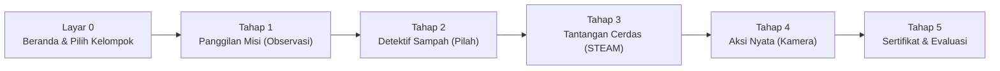

# Aturan & Mekanisme Permainan (Game Rules)
> **MISI CILIK: Selamatkan Lingkungan!**  
> Standar interaksi, diferensiasi Kelompok A & B, mode antarmuka (Anak vs Guru), validasi jawaban, asesmen berbasis bukti, dan sistem penghargaan bintang.

---

## 1. Ikhtisar Alur Permainan & Hierarki Judul

Permainan mengadopsi struktur judul bertingkat untuk mengakomodasi berbagai sub-tema lingkungan hidup:
* **Judul Payung Utama:** `MISI CILIK: SELAMATKAN LINGKUNGAN!`
* **Judul Sub-Tema Aktif Dinamis:** Berganti otomatis saat tema dipilih:
  * Tema 1: `SELAMATKAN TAMAN CERIA!` (Taman Bunga Asri)
  * Tema 2: `SELAMATKAN PANTAI & LAUT!` (Ekosistem Pesisir & Biota Laut)
  * Tema 3: `SELAMATKAN KEBUN BINATANG!` (Kandang Hewan & Satwa Liar)
  * Tema 4: `SELAMATKAN KELASKU!` (Ruang Kelas Bersih & Rapi)

Permainan terdiri dari **1 Layar Utama (Home)** dan **5 Tahap Misi Edukatif** berurutan. Setiap tahap dirancang dengan prinsip **Diferensiasi Fase Fondasi** untuk mengakomodasi anak usia 4–5 tahun (Kelompok A) dan usia 5–6 tahun (Kelompok B).

---

## 2. Arsitektur Dual-Mode: Mode Anak vs Mode Guru/Juri

Untuk menjaga fokus anak dan profesionalitas saat presentasi lomba, antarmuka dipisahkan menjadi dua mode:

### 🧒 Mode Anak (Child / Play Mode):
* **Fokus:** Sederhana, ceria, tombol ekstra besar ($\ge 72\text{px}$), visual atraktif, dan umpan balik suara instan.
* **Tampilan Bersih:** Elemen teknis seperti konfigurasi AI, editor JSON, dan SOP presentasi disembunyikan agar anak tidak terdistraksi dan dapat bermain mandiri.

### 👩‍🏫 Mode Guru / Juri (Teacher / Jury Cockpit):
* **Fokus:** Instrumen evaluasi guru, demonstrasi inovasi AI, dan fleksibilitas kompetisi.
* **Fitur Terbuka:**
  * **Tab 1: Panduan Lomba & Kurikulum:** Pemetaan CP, TP terukur, dan SOP presentasi 5 menit.
  * **Tab 2: Ubah Tema Cepat (Live Switcher):** 4 preset tema lengkap sekali klik.
  * **Tab 3: Data Hasil Murid (Local Storage):** Rekapitulasi nilai, cetak ulang sertifikat, dan hapus riwayat.
* **Akses:** Diaktifkan melalui tombol panel juri di header (`📋 Panel Juri`) atau pintasan guru.

---

## 3. Aturan Layar & Gameplay Tiap State

### Layar 0: Beranda (Home Screen) & Seleksi Kelompok Usia
* **Tujuan Pembelajaran:** Menumbuhkan rasa ingin tahu, memperkenalkan karakter maskot, memilih kelompok jenjang usia, dan memasukkan identitas murid.
* **Elemen Interaktif:**
  * **Selektor Kelompok Usia (Diferensiasi Pembelajaran):**
    * `🐥 Kelompok A (Usia 4–5 Tahun)`: Misi bertahap konkret, 4 item sampah mudah, membilang angka 1–5 berbantuan gambar.
    * `🦉 Kelompok B (Usia 5–6 Tahun)`: Misi mandiri analitis, 6 item sampah berbobot ilmiah sebab-akibat, membilang angka 1–10.
  * **Input Nama Murid:** Kotak input nama panggilan anak yang akan disematkan pada sertifikat penghargaan dan lembar evaluasi guru.
  * **Panggung Video Animasi:** Video animasi AI (`cerita_taman.mp4`, `cerita_pantai.mp4`, dll.) yang otomatis berganti sesuai sub-tema aktif.
  * **Tombol Raksasa:** `"🚀 MULAI MISI SEKARANG!"` → memvalidasi kelompok, membuka kunci audio, dan berpindah ke Tahap 1.

---

### Layar 1: Tahap 1 — Panggilan Misi (Observasi & Bahasa)
* **Tujuan Pembelajaran Terukur:** Anak mampu mengidentifikasi minimal 2 kondisi lingkungan kotor dan menyampaikan gagasan pemecahan masalah secara lisan.
* **Mekanisme Permainan:**
  1. Anak menyaksikan visual lingkungan yang membutuhkan bantuan (sampah berantakan, tanaman layu, laut kotor, dll.).
  2. Tombol `"▶️ Putar Cerita Animasi"` mengaktifkan narasi suara TTS maskot secara otomatis.
  3. Guru memandu diskusi menggunakan 3 pertanyaan pemantik yang **berbeda sesuai kelompok usia**:
     * **Kelompok A (Fokus Observasi Konkret):**
       1. *"Anak-anak pintar, apa saja benda yang membuat tempat ini jadi kotor?"*
       2. *"Kira-kira apa yang dirasakan tanaman jika kekurangan air?"*
       3. *"Siapa anak hebat yang mau ikut membantu merawat tempat ini?"*
     * **Kelompok B (Fokus Analisis Sebab-Akibat & Solusi):**
       1. *"Menurut teman-teman, mengapa sampah bisa sampai menumpuk dan berserakan di tempat ini?"*
       2. *"Apa bahayanya bagi lingkungan dan hewan jika sampah dibiarkan berhari-hari?"*
       3. *"Bagaimana cara kita mengajak orang lain agar tidak membuang sampah sembarangan?"*
  4. Ketika anak merespons, guru menekan tombol `"🗣️ Anak Sudah Berpendapat (+1 ⭐)"`.
  5. Sistem memutar SFX tepuk tangan meriah, menambah 1 bintang, dan membuka tombol `"Lanjut ke Misi Detektif ➔"`.
  6. Layar dilengkapi tombol navigasi `"⬅ Kembali"` menuju Beranda.

---

### Layar 2: Tahap 2 — Misi Detektif Sampah (Kognitif & Motorik)
* **Tujuan Pembelajaran Terukur:** Anak mampu mengklasifikasikan sampah organik (alami) dan anorganik (buatan) ke dalam wadah yang sesuai dengan tepat.
* **Wadah Pemilahan:**
  * **Tong Hijau:** Sampah Organik (Alami, mudah membusuk, daun kering, sisa makanan).
  * **Tong Kuning:** Sampah Anorganik (Plastik, kaleng, kemasan pabrik).
* **Mekanisme Input Ganda (Dual-Input UX):**
  * **Mode 2-Klik (Click-to-Select, Click-to-Drop):** Solusi ideal layar proyektor sentuh TK.
  * **Mode Drag-and-Drop:** Alternatif seret-lepas dengan mouse komputer.
* **Diferensiasi Item Sampah Antar Kelompok (Revisi Kurikulum):**
  * **🐥 Kelompok A (4 Item Sampah Konkret & Kontras Tinggi):**
    * *Taman Ceria A:* Kulit Pisang (`🍌`), Daun Kering (`🍂`) vs Botol Plastik (`🧴`), Kantong Kresek (`🛍️`).
    * *Pantai & Laut A:* Kulit Apel (`🍎`), Daun Kelapa Kering (`🍂`) vs Botol Plastik (`🧴`), Sedotan Plastik (`🥤`).
    * *Kebun Binatang A:* Kulit Pisang (`🍌`), Daun Bambu (`🎍`) vs Bungkus Snack (`🍿`), Botol Plastik (`🍼`).
    * *Kelasku Rapi A:* Kulit Jeruk (`🍊`), Kertas Bekas (`📄`) vs Gelas Plastik (`🥤`), Kotak Kemasan Plastik (`🧃`).
    * *Panduan:* Instruksi ramah anak berfokus pada perbedaan bahan alami vs plastik.
  * **🦉 Kelompok B (6 Item Sampah Menantang + Alasan Edukatif Ilmiah):**
    * *Taman Ceria B:* Pisang, Daun Kering, Apel vs Botol Plastik, Kaleng Logam, Kantong Kresek.
    * *Pantai & Laut B:* Rumput Laut, Cangkang Kerang, Kayu Lapuk vs Botol Plastik, Jaring Ikan Kusut, Sedotan Plastik.
    * *Kebun Binatang B:* Kulit Kacang, Batang Pisang, Daun Bambu vs Kemasan Plastik Snack, Botol Sirup, Baterai Bekas B3.
    * *Kelasku Rapi B:* Serutan Pensil Kayu, Kertas Bekas, Kulit Jeruk vs Wadah Mika Plastik, Spidol Bekas Rusak, Selotip Plastik.
    * *Fitur Khusus:* Setiap kartu sampah memiliki badge **Alasan Ilmiah Sebab-Akibat** (misal: *"Jaring plastik bisa menjerat penyu"*, *"Baterai bekas beracun bagi hewan"*).
* **Aturan Umpan Balik (Zero Punishment Policy):**
  * **Benar:** SFX *Chime* gembira, animasi bintang terbang, sampah mengecil ke dalam tong, dan suara TTS memvalidasi alasan/jenis sampah.
  * **Salah:** SFX nada lembut pembinaan, tong bergetar pelan (*soft-shake*), sampah kembali ke posisi semula, dan suara TTS memberikan arahan bersahabat: *"Ayo perhatikan lagi, apakah benda ini mudah membusuk atau dari plastik/kaleng?"*.
* **Mini-Kuis Penyelamatan Lingkungan:**
  * Memilih alat penyelamatan (misal: `🚿 Alat Siram Air` / `✂️ Gunting Bebaskan Penyu` / `🥕 Pakan Sehat Satwa` / `🧽 Penghapus Papan Tulis`).
  * Jawaban tepat memberikan **+1 ⭐** dan membuka akses ke Tahap 3.
  * Dilengkapi tombol navigasi `⬅ Kembali` menuju Tahap 1.

---

### Layar 3: Tahap 3 — Tantangan Cerdas (Numerasi & Sains STEAM)

#### Sub-Tantangan 3A: Berhitung Objek Lingkungan (Numerasi Mandiri)
* **Tujuan Pembelajaran Terukur:** Anak mampu membilang objek lingkungan secara berurutan dengan korespondensi satu-satu tanpa bantuan petunjuk angka langsung.
* **Prinsip Bebas Bocoran Angka (No Answer Leak):**
  * **Instruksi Narasi:** Langsung mengajak anak mengamati dan menghitung objek secara mandiri di layar. **Tidak boleh menyebutkan angka target** seperti *"Ayo berhitung sampai 8"*.
  * **Teks Instruksi Baru:** *"Wah, lihat ada [benda] di layar! Ayo sentuh dan hitung satu per satu, lalu tebak ada berapa jumlahnya ya!"*.
* **Penyesuaian Objek Numerasi Sesuai Sub-Tema Aktif:**
  * 🌻 **Taman Ceria:** Menghitung **Bunga Matahari** (`🌻`)
  * 🌊 **Pantai & Laut:** Menghitung **Bintang Laut** (`⭐`) *(Revisi: bukan bunga matahari)*
  * 🦁 **Kebun Binatang:** Menghitung **Hewan / Satwa Safari** (`🦁`) *(Revisi: bukan bunga matahari)*
  * 🏫 **Kelasku Rapi:** Menghitung **Peralatan Sekolah / Buku** (`📚`) *(Revisi: bukan bunga matahari)*
* **Diferensiasi Rentang Bilangan:**
  * **Kelompok A:** Objek berjumlah **5**, pilihan kartu angka: `[3]`, `[4]`, `[5]`.
  * **Kelompok B:** Objek berjumlah **10**, pilihan kartu angka adaptif: `[8]`, `[9]`, `[10]`.
* **Umpan Balik Verbal:** Setiap objek yang disentuh memunculkan animasi label angka dan dibacakan urutannya oleh TTS (*"Satu!"*, *"Dua!"*, dst.).

#### Sub-Tantangan 3B: Mengurutkan Siklus Alami / Metamorfosis (Sains)
* **Tujuan Pembelajaran Terukur:** Anak mampu mengurutkan 4 tahapan kronologis siklus hidup tanaman atau metamorfosis hewan.
* **Diferensiasi Kelompok:**
  * **Kelompok A:** Diberi perancah visual berupa label nomor urut (`1. Biji`, `2. Tunas`, `3. Siram`, `4. Bunga`).
  * **Kelompok B:** Kartu mandiri **tanpa nomor urut** (`Tanam Biji`, `Tumbuh Tunas`, `Siram Air`, `Bunga Mekar`). Setelah urutan lengkap, TTS membacakan penjelasan sains sebab-akibat komprehensif.
* Menyelesaikan kedua sub-tantangan memberikan **+1 ⭐** dan membuka akses ke Tahap 4.
* Dilengkapi tombol navigasi `⬅ Kembali` menuju Tahap 2.

---

### Layar 4: Tahap 4 — Aksi Nyata Penyelamat Lingkungan (Sosial-Emosional & Motorik)
* **Tujuan Pembelajaran Terukur:** Anak mempraktikkan langsung perilaku peduli lingkungan di kelas atau sekolah serta menunjukkan sikap gotong royong bersama teman sebaya.
* **Fitur Utama:**
  * **Timer Hitung Mundur 60 Detik:** Memandu dinamika aktivitas fisik di kelas dengan tombol `Mulai`, `Jeda`, dan `Lewati`.
  * **Diferensiasi Checklist Aksi Nyata:**
    * **Kelompok A (2 Aksi Terbimbing):**
      * `☑️ Mengambil sampah di sekitar dan membuang ke tempat sampah`
      * `☑️ Ikut menyiram atau merawat tanaman bersama Ibu Guru`
    * **Kelompok B (3 Aksi Mandiri & Kolaboratif):**
      * `☑️ Mengambil dan memilah sampah organik vs anorganik di sekitar`
      * `☑️ Merawat lingkungan dan mengingatkan teman menjaga kebersihan`
      * `☑️ Bekerja sama dan merapikan kembali peralatan setelah beraktivitas`
  * **Kamera Bukti Aksi (`getUserMedia`):**
    * **Kebijakan Izin Pengguna:** Kamera **hanya aktif jika diberikan izin eksplisit** oleh guru/pengguna.
    * Menampilkan video langsung (*live feed*) cermin ekspresi anak.
    * Tombol `"Ambil Foto"` merekam foto aksi anak untuk sertifikat.
    * **Safe Fallback:** Jika kamera ditolak atau tidak ada, sistem otomatis menampilkan ilustrasi avatar anak hebat tanpa error.
  * Menyelesaikan tahap ini memberikan **+1 ⭐** dan membuka gerbang Tahap 5.
  * Dilengkapi tombol navigasi `⬅ Kembali` menuju Tahap 3.

---

### Layar 5: Tahap 5 — Misi Berhasil & Asesmen Berbasis Bukti Pengamatan
* **Tujuan Pembelajaran Terukur:** Anak mengekspresikan rasa bangga atas keberhasilan belajarnya dan guru mencatat ketercapaian kompetensi berdasarkan bukti pengamatan riil.
* **Fitur Utama:**
  * **Selebrasi Kemenangan:** Hujan confetti visual dan transformasi visual before-after lingkungan yang bersih.
  * **Sertifikat Digital Siap Cetak:**
    * Memuat Nama Murid, Badge Kelompok Usia (`🐥 Kelompok A` / `🦉 Kelompok B`), Sub-Tema yang diselesaikan, Foto aksi dari Tahap 4, dan **5 Bintang Emas Penuh (⭐⭐⭐⭐⭐)**.
    * Tombol cetak ramah kertas (`Print Stylesheet`).
  * **Lembar Asesmen Guru Berbasis Bukti Pengamatan (Evidence-Based Assessment):**
    * **Bukan Nilai Otomatis:** Predikat BB, MB, BSH, BSB **tidak diberikan secara otomatis oleh sistem semata**. Guru mencatat hasil pengamatan berdasarkan perilaku nyata anak selama bermain:
      1. *NAM:* Anak terbiasa menyayangi ciptaan Tuhan dan peduli lingkungan.
      2. *Kognitif:* Anak mampu memilah sampah sesuai kategori dengan tepat.
      3. *Bahasa:* Anak berani menyampaikan pendapat sederhana saat diskusi lingkungan.
      4. *Numerasi:* Anak mampu membilang objek secara urut dan mandiri.
      5. *Fisik Motorik:* Anak tangkas berinteraksi di layar dan aktif dalam aksi fisik nyata.
      6. *Sosial-Emosional:* Anak mampu bekerja sama dan tertib bergantian dengan teman.
    * Guru dapat mengklik tombol skala (BB, MB, BSH, BSB) pada lembar observasi sesuai kondisi anak sesungguhnya.
  * **Sistem Rekapitulasi Murid Otomatis (Local Storage):**
    * Menyimpan: Nama murid, Kelompok (A/B), Sub-tema, Bintang (5/5), Tanggal bermain, Nilai hasil observasi guru, dan Foto aksi.
    * **Akses di Panel Juri Tab 3:** Guru dapat meninjau portofolio seluruh kelas, mencetak ulang sertifikat per murid, atau menghapus catatan.

---

## 4. Sistem Bintang & Skoring (Scoring Logic)

Total Bintang Maksimal: **5 Bintang Emas (`⭐⭐⭐⭐⭐`)**

| Tahap | Aktivitas Pemicu Bintang | Skor |
| :---: | :--- | :---: |
| **Tahap 1** | Anak aktif berpendapat dalam diskusi pemantik guru | `+1 ⭐` |
| **Tahap 2** | Berhasil memilah seluruh sampah + memilih alat bantu penyelamatan | `+1 ⭐` |
| **Tahap 3** | Menyelesaikan kuis hitung objek lingkungan & urutan siklus sains | `+1 ⭐` |
| **Tahap 4** | Mempraktikkan checklist aksi nyata & foto bersama di kelas | `+1 ⭐` |
| **Tahap 5** | Bonus selebrasi atas penyelesaian misi paripurna | `+1 ⭐` |
| **Total** | **Gelar Resmi: Penyelamat Lingkungan Cilik Teladan** | **5 ⭐** |
