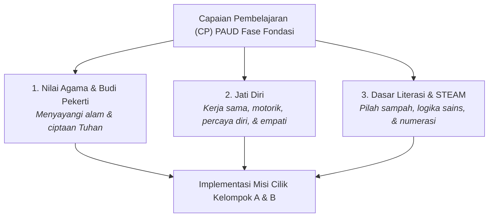

# Penyelarasan Kurikulum Merdeka PAUD & Aspek Perkembangan
> **MISI CILIK: Selamatkan Lingkungan!**  
> Integrasi Capaian Pembelajaran (CP), Tujuan Pembelajaran (TP), dan Diferensiasi Fase Fondasi Kelompok A (4–5 Tahun) & Kelompok B (5–6 Tahun).

---

## 1. Pemetaan Capaian Pembelajaran (CP) Kurikulum Merdeka PAUD

Aplikasi *MISI CILIK* mengintegrasikan 3 Elemen Utama Capaian Pembelajaran Kurikulum Merdeka Fase Fondasi (PAUD / TK Kelompok A & B):

### Rincian 3 Elemen CP:
1. **Elemen Nilai Agama dan Budi Pekerti:**
   * Anak mengenali, menghargai, dan menyayangi ciptaan Tuhan serta mempraktikkan perilaku hidup bersih dan merawat lingkungan sekitar.
2. **Elemen Jati Diri:**
   * Anak mengenali emosi, mandiri, mampu bekerja sama dengan teman sebaya, serta memiliki koordinasi motorik halus dan kasar yang terasah.
3. **Elemen Dasar-Dasar Literasi, Matematika, Sains, Teknologi, Rekayasa, dan Seni (STEAM):**
   * Anak mampu menyimak dan menyampaikan gagasan secara lisan, memecahkan masalah kontekstual sederhana, mengelompokkan benda, menalar urutan logis, dan mengenal konsep lambang bilangan.

---

## 2. Prinsip Diferensiasi Pembelajaran Fase Fondasi (Kelompok A vs Kelompok B)

Sesuai pedoman Kurikulum Merdeka PAUD, media pembelajaran ini dirancang dengan pendekatan **Diferensiasi Pembelajaran** (*Developmentally Appropriate Practice* / DAP) yang membedakan tingkat kompleksitas tantangan antara Kelompok A (usia 4–5 tahun) dan Kelompok B (usia 5–6 tahun):

| Dimensi Pembelajaran | Kelompok A (Usia 4–5 Tahun) 🐥 | Kelompok B (Usia 5–6 Tahun) 🦉 |
| :--- | :--- | :--- |
| **Karakteristik Berpikir** | Konkret-intuitif, butuh bantuan visual eksplisit (*scaffolding*). | Mulai menalar sebab-akibat, mandiri, dan mampu membuat perbandingan. |
| **Rentang Numerasi** | Membilang angka **1 hingga 5** dengan korespondensi satu-satu. | Membilang angka **1 hingga 10** secara teratur dan mandiri. |
| **Pertanyaan Diskusi (Tahap 1)** | Pertanyaan **observasi konkret** langsung (contoh: *"Benda apa yang kotor?"*). | Pertanyaan **analisis sebab-akibat** (contoh: *"Mengapa sampah bisa menumpuk dan apa akibatnya?"*). |
| **Pilah Sampah (Tahap 2)** | Memilah 2 kategori sampah dengan bimbingan visual dan audio ramah. | Memilah 2 kategori sampah dilengkapi **alasan edukatif ilmiah sederhana** pada setiap item. |
| **Urutan Sains (Tahap 3B)** | Diberi bantuan **nomor urut eksplisit** pada kartu (`1. Biji`, `2. Tunas`, dst.). | Kartu **konsep mandiri tanpa nomor**, diakhiri penjelasan sains sebab-akibat komprehensif. |
| **Aksi Nyata (Tahap 4)** | **2 checklist aksi nyata konkret** dipandu oleh guru di kelas. | **3 checklist aksi nyata kolaboratif & mandiri** bersama teman sebaya. |

---

## 3. Matriks Tujuan Pembelajaran (TP) Khusus

Berdasarkan capaian di atas, dirumuskan Tujuan Pembelajaran operasional yang disesuaikan per kelompok:

| Tahap | Capaian / Aspek | Tujuan Pembelajaran (Kelompok A) | Tujuan Pembelajaran (Kelompok B) |
| :---: | :--- | :--- | :--- |
| **Tahap 1** | Bahasa & Kepedulian | Anak mampu menyebutkan benda-benda kotor yang ada di lingkungan secara lisan. | Anak mampu menceritakan penyebab lingkungan kotor dan usulan solusi sederhana. |
| **Tahap 2** | Kognitif Klasifikasi | Anak mampu mengelompokkan sampah alami vs buatan ke dalam tong yang tepat. | Anak mampu memilah sampah dan memahami alasan mengapa plastik berbahaya bagi alam. |
| **Tahap 3A** | Numerasi Dasar | Anak mampu membilang benda berjumlah **1 sampai 5** secara runtut. | Anak mampu membilang benda berjumlah **1 sampai 10** secara mandiri dan tepat. |
| **Tahap 3B** | Sains & Nalar Kritis | Anak mampu menyusun 4 kartu siklus pertumbuhan berbantuan nomor urut. | Anak mampu menalar urutan perkembangan siklus hidup alami tanpa panduan nomor. |
| **Tahap 4** | Sosial-Emosional & Motorik | Anak terbiasa membuang sampah pada tempatnya dan menyiram tanaman dengan bimbingan. | Anak mampu bekerja sama, memilah sampah nyata, dan merapikan alat bersama teman. |
| **Tahap 5** | Refleksi & Apresiasi | Anak merasa bangga atas kontribusinya dan senang menerima apresiasi bintang. | Anak mampu merefleksikan pentingnya menjaga kebersihan secara konsisten setiap hari. |

---

## 4. Matriks 6 Aspek Perkembangan Anak Usia Dini

Setiap langkah dalam *MISI CILIK* secara spesifik menstimulasi 6 aspek perkembangan anak TK:

| No | Aspek Perkembangan | Indikator Kompetensi Anak TK | Wadah Stimulasi dalam Aplikasi |
| :---: | :--- | :--- | :--- |
| **1** | **Nilai Agama & Moral (NAM)** | Menunjukkan rasa syukur dan cinta lingkungan dengan merawat ciptaan Tuhan serta tidak membuang sampah sembarangan. | **Tahap 1 & Tahap 2:** Narasi mengajak merawat alam ciptaan Tuhan; sub-kuis memilih benda penyiram air bagi tanaman. |
| **2** | **Kognitif & Sains** | Mengklasifikasikan benda berdasarkan sifatnya, memahami hubungan sebab-akibat sederhana, dan menalar urutan kronologis. | **Tahap 2 & Tahap 3B:** Memilah sampah organik vs anorganik; menyusun 4 urutan tumbuhnya tanaman/metamorfosis. |
| **3** | **Bahasa** | Menyimak arahan audio secara saksama dan mampu mengungkapkan pendapat lisan dengan kalimat sendiri. | **Tahap 1:** Menyimak suara TTS maskot Ara dan menjawab pertanyaan pemantik guru. |
| **4** | **Numerasi & Logika** | Membilang benda (korespondensi satu-satu) dan menghubungkannya dengan lambang bilangan. | **Tahap 3A:** Menyentuh objek berurutan disertai suara hitungan verbal dan memilih lambang angka yang benar. |
| **5** | **Fisik & Motorik** | Koordinasi mata-tangan (motorik halus) dan kelincahan gerakan fisik nyata di kelas (motorik kasar). | **Tahap 2:** Sentuhan/klik target layar. **Tahap 4:** Aksi fisik membuang sampah dan berfoto bersama. |
| **6** | **Sosial-Emosional & Digital** | Bekerja sama, bergantian, percaya diri tampil di depan cermin kamera proyektor, serta memahami etika digital sederhana. | **Tahap 4 & Tahap 5:** Checklist gotong royong, foto webcam bersama teman, sertifikat digital bintang emas. |

---

## 5. Lembar Observasi Perkembangan Guru (Rubrik Tahap 5)

Pada Tahap 5, guru disajikan instrumen asesmen autentik cepat. Lembar ini dilengkapi **Toggle Switch Kelompok Usia** (`🐥 Kelompok A` / `🦉 Kelompok B`) yang **secara dinamis mengubah deskripsi indikator** agar tepat sasaran:

### Kriteria Skala Perkembangan:
* **BB:** Belum Berkembang
* **MB:** Mulai Berkembang
* **BSH:** Berkembang Sesuai Harapan
* **BSB:** Berkembang Sangat Baik

### Perbandingan Indikator Rubrik Aplikasi:

| Aspek | Indikator Kelompok A (Usia 4–5 Thn) | Indikator Kelompok B (Usia 5–6 Thn) |
| :--- | :--- | :--- |
| **NAM** | Terbiasa peduli lingkungan dan menyayangi tanaman ciptaan Tuhan dengan bimbingan. | Menunjukkan inisiatif merawat lingkungan alam dan menyayangi ciptaan Tuhan secara mandiri. |
| **Kognitif** | Mampu membedakan sampah alami vs buatan serta menyusun urutan bergambar dengan bantuan visual. | Mampu memilah sampah disertai alasan sederhana dan menalar urutan siklus sains tanpa bantuan nomor. |
| **Bahasa** | Menyimak arahan audio dan menjawab pertanyaan pemantik sederhana tentang kondisi lingkungan. | Mampu menceritakan masalah lingkungan secara runut serta mengemukakan ide solusi secara aktif. |
| **Numerasi** | Lancar membilang 1–5 dengan menyentuh objek bunga dan mengenali lambang bilangannya. | Terampil membilang 1–10 secara mandiri serta mencocokkan jumlah dengan lambang bilangan yang tepat. |
| **Fisik Motorik** | Terampil mengoordinasikan mata dan tangan pada layar sentuh serta melakukan aksi bersih-bersih kelas. | Menunjukkan koordinasi motorik halus yang mantap serta kelincahan fisik saat bergotong royong di kelas. |
| **Sosial-Emosional** | Senang bekerja sama, sabar menunggu giliran, dan antusias berfoto bersama teman. | Menunjukkan kemandirian, kepedulian pada teman, tanggung jawab menjaga kelas, dan bangga atas prestasinya. |

> [!NOTE]
> Seluruh hasil penilaian rubrik dan data partisipasi anak ini otomatis disimpan ke dalam **Local Storage peramban**, memudahkan guru merekap ketercapaian kompetensi seluruh murid di kelas tanpa beban administrasi manual.
