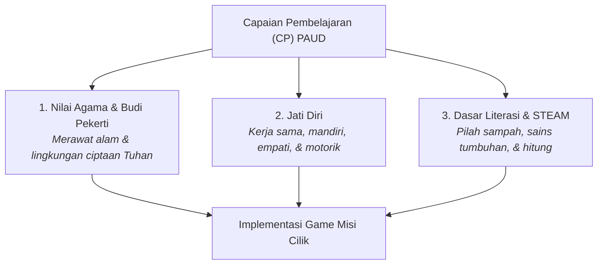

# Penyelarasan Kurikulum Merdeka PAUD & Aspek Perkembangan
> **MISI CILIK: Selamatkan Taman Ceria!**  
> Integrasi Capaian Pembelajaran (CP), Tujuan Pembelajaran (TP), dan 6 Aspek Perkembangan Anak Usia Dini.

---

## 1. Pemetaan Capaian Pembelajaran (CP) Kurikulum Merdeka PAUD

Aplikasi *MISI CILIK* mengintegrasikan 3 Elemen Utama Capaian Pembelajaran Kurikulum Merdeka Fase Fondasi (PAUD / TK Kelompok A & B):

### Rincian Elemen CP:
1. **Elemen Nilai Agama dan Budi Pekerti:**
   * *Sub-Capaian:* Anak mengenali dan mempraktikkan perilaku menyayangi serta merawat lingkungan alam sebagai bentuk rasa syukur terhadap ciptaan Tuhan.
2. **Elemen Jati Diri:**
   * *Sub-Capaian:* Anak mampu mengekspresikan emosi positif, memiliki rasa percaya diri, bekerja sama dalam kelompok, serta menggunakan fungsi motorik secara terkoordinasi.
3. **Elemen Dasar-Dasar Literasi, Matematika, Sains, Teknologi, Rekayasa, dan Seni (STEAM):**
   * *Sub-Capaian:* Anak mampu menyimak dan menyampaikan pesan secara lisan, memecahkan masalah sehari-hari melalui eksplorasi sains (mengelompokkan sampah, siklus hidup tanaman), serta mengenal konsep bilangan dasar 1–5.

---

## 2. Tujuan Pembelajaran (TP) Khusus

Berdasarkan CP di atas, dirumuskan Tujuan Pembelajaran operasional yang langsung diuji dalam permainan:

1. **TP 1:** Anak dapat menunjukkan kepedulian terhadap kebersihan lingkungan sekitar melalui identifikasi tempat kotor vs bersih.
2. **TP 2:** Anak mampu mengelompokkan benda berdasarkan jenis sampah organik (alami) dan anorganik (buatan manusia/plastik).
3. **TP 3:** Anak mampu membilang benda secara berurutan dari angka 1 hingga 5.
4. **TP 4:** Anak mampu mengurutkan tahapan siklus pertumbuhan tanaman secara kronologis sederhana.
5. **TP 5:** Anak mampu mengungkapkan pendapat secara verbal saat diajak berdiskusi tentang masalah lingkungan.
6. **TP 6:** Anak mempraktikkan secara nyata aksi membersihkan kelas dan menyiram tanaman bersama guru dan teman sebaya.

---

## 3. Matriks 6 Aspek Perkembangan Anak Usia Dini

Setiap langkah dalam *MISI CILIK* secara spesifik menstimulasi indikator perkembangan anak TK:

| No | Aspek Perkembangan | Indikator Kompetensi Anak TK | Wadah Stimulasi dalam Aplikasi |
| :---: | :--- | :--- | :--- |
| **1** | **Nilai Agama & Moral (NAM)** | Menunjukkan rasa syukur dan cinta lingkungan dengan tidak membuang sampah sembarangan serta merawat tanaman. | **Tahap 1 & Tahap 2:** Narasi mengajak merawat taman ciptaan Tuhan; menyiram tanaman yang layu. |
| **2** | **Kognitif** | Mengklasifikasikan benda berdasarkan sifatnya, memahami hubungan sebab-akibat, dan menalar urutan logis. | **Tahap 2 & Tahap 3B:** Memilah sampah organik vs anorganik; menyusun 4 urutan tumbuhnya tanaman. |
| **3** | **Bahasa** | Menyimak instruksi lisan dengan saksama dan mampu menjawab pertanyaan sederhana dengan kalimat sendiri. | **Tahap 1:** Menyimak suara narasi TTS karakter Ara dan menjawab 3 pertanyaan pemantik guru. |
| **4** | **Numerasi & Logika Matematika** | Membilang benda (korespondensi satu-satu) 1 sampai 5 dan mengenali lambang bilangan. | **Tahap 3A:** Menyentuh 5 bunga matahari berurutan disertai suara hitungan dan memilih kartu angka `5`. |
| **5** | **Fisik & Motorik (Halus & Kasar)** | Koordinasi mata-tangan saat berinteraksi dengan layar (motorik halus) dan aksi fisik nyata (motorik kasar). | **Tahap 2:** Sentuhan/klik target layar. **Tahap 4:** Gerakan fisik membuang sampah nyata & menyiram bunga. |
| **6** | **Sosial-Emosional & Digital** | Bekerja sama, sabar menunggu giliran, percaya diri tampil di depan kamera proyektor. | **Tahap 4 & Tahap 5:** Checklist gotong royong, foto webcam bersama teman, apresiasi sertifikat bintang. |

---

## 4. Lembar Observasi Perkembangan Guru (Rubrik Tahap 5)

Pada Tahap 5, guru disajikan instrumen evaluasi cepat dengan kriteria perkembangan:
* **BB:** Belum Berkembang
* **MB:** Mulai Berkembang
* **BSH:** Berkembang Sesuai Harapan
* **BSB:** Berkembang Sangat Baik

| Aspek yang Diamati | Indikator Pengamatan Lapangan | Skala Default Game |
| :--- | :--- | :---: |
| **NAM** | Memiliki kepedulian terhadap kebersihan lingkungan | `BSH / BSB` |
| **Kognitif** | Mampu memilah sampah dan memahami urutan tanaman | `BSH / BSB` |
| **Bahasa** | Berani menyampaikan pendapat saat diskusi pemantik | `BSH / BSB` |
| **Numerasi** | Lancar membilang 1–5 saat menyentuh bunga | `BSH / BSB` |
| **Fisik Motorik** | Trampil memegang mouse / menyentuh layar / aksi nyata | `BSH / BSB` |
| **Sosial-Emosional** | Mampu bekerja sama dan tertib bergantian | `BSH / BSB` |
