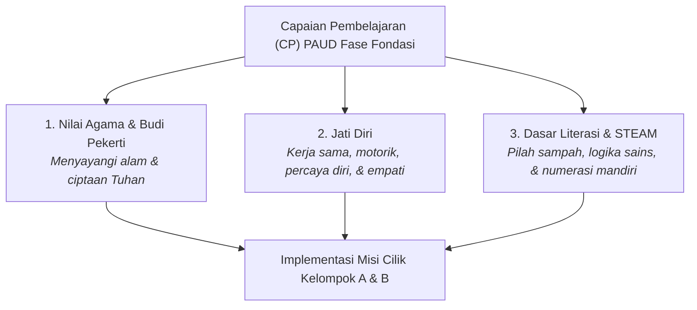

# Penyelarasan Kurikulum Merdeka PAUD & Aspek Perkembangan
> **MISI CILIK: Selamatkan Lingkungan!**  
> Integrasi Capaian Pembelajaran (CP), Tujuan Pembelajaran (TP) Terukur, Diferensiasi Fase Fondasi Kelompok A (4–5 Tahun) & Kelompok B (5–6 Tahun), dan Asesmen Berbasis Bukti Pengamatan.

---

## 1. Pemetaan Capaian Pembelajaran (CP) Kurikulum Merdeka PAUD

Aplikasi *MISI CILIK* mengintegrasikan 3 Elemen Utama Capaian Pembelajaran Kurikulum Merdeka Fase Fondasi (PAUD / TK Kelompok A & B):

### Rincian 3 Elemen CP:
1. **Elemen Nilai Agama dan Budi Pekerti:**
   * Anak mengenali, menghargai, dan menyayangi ciptaan Tuhan serta mempraktikkan perilaku hidup bersih dan merawat lingkungan sekitar.
2. **Elemen Jati Diri:**
   * Anak mengenali emosi, mandiri, mampu bekerja sama dengan teman sebaya, serta memiliki koordinasi motorik halus dan kasar yang terkoordinasi dengan baik.
3. **Elemen Dasar-Dasar Literasi, Matematika, Sains, Teknologi, Rekayasa, dan Seni (STEAM):**
   * Anak mampu menyimak dan menyampaikan gagasan secara lisan, memecahkan masalah kontekstual sederhana, mengelompokkan benda, menalar urutan logis, dan mengenal konsep lambang bilangan melalui penghitungan mandiri.

---

## 2. Prinsip Diferensiasi Pembelajaran Fase Fondasi (Kelompok A vs Kelompok B)

Sesuai pedoman Kurikulum Merdeka PAUD, media pembelajaran ini dirancang dengan pendekatan **Diferensiasi Pembelajaran** (*Developmentally Appropriate Practice* / DAP) yang membedakan tingkat kompleksitas tantangan antara Kelompok A (usia 4–5 tahun) dan Kelompok B (usia 5–6 tahun):

| Dimensi Pembelajaran | Kelompok A (Usia 4–5 Tahun) 🐥 | Kelompok B (Usia 5–6 Tahun) 🦉 |
| :--- | :--- | :--- |
| **Karakteristik Kognitif** | Berpikir konkret-intuitif, butuh bantuan visual terfokus (*scaffolding*). | Mulai menalar sebab-akibat, mandiri, dan mampu membuat pertimbangan dampak lingkungan. |
| **Pilah Sampah (Tahap 2)** | **4 Item Sampah Konkret:** 2 Organik vs 2 Anorganik kontras tinggi (pisang/apel/daun vs botol/kresek). | **6 Item Sampah Lengkap:** Disertai **Alasan Edukatif Ilmiah Sebab-Akibat** (mikroplastik, jaring penyu, baterai B3). |
| **Rentang Numerasi (Tahap 3A)** | Membilang **1 hingga 5** objek lingkungan secara mandiri (korespondensi satu-satu). | Membilang **1 hingga 10** objek lingkungan secara teratur dan mandiri. |
| **Instruksi Numerasi** | **Bebas bocoran angka:** Anak diarahkan langsung menyentuh & menghitung objek di layar. | **Bebas bocoran angka:** Anak menghitung mandiri hingga 10 dan memilih kartu angka yang tepat. |
| **Objek Numerasi Sesuai Tema** | Taman: Bunga Matahari (`🌻`), Pantai: Bintang Laut (`⭐`), Zoo: Hewan Safari (`🦁`), Kelas: Peralatan Sekolah (`📚`). | Sama (berganti dinamis sesuai tema yang dipilih). |
| **Urutan Sains (Tahap 3B)** | Kartu berbantuan **nomor urut eksplisit** (`1. Biji`, `2. Tunas`, dst.). | Kartu **konsep mandiri tanpa nomor urut**, diakhiri narasi sains sebab-akibat komprehensif. |
| **Aksi Nyata (Tahap 4)** | **2 checklist aksi nyata terbimbing** bersama guru di kelas. | **3 checklist aksi nyata kolaboratif & mandiri** bersama teman sebaya. |

---

## 3. Matriks Tujuan Pembelajaran (TP) Terukur & Keterkaitan Aktivitas

Setiap misi memiliki hubungan erat antara **Tujuan Pembelajaran Terukur**, **Aktivitas Interaktif Anak**, dan **Indikator Keberhasilan Teramati**:

| Tahap Misi | Tujuan Pembelajaran Terukur (TP) | Aktivitas Interaktif Anak | Indikator Ketercapaian Teramati |
| :---: | :--- | :--- | :--- |
| **Tahap 1: Panggilan Misi** | Anak mampu mengidentifikasi kondisi lingkungan kotor dan mengemukakan pendapat solusi secara lisan dengan kalimat sederhana. | Mengamati animasi skenario kotor, menyimak narasi TTS maskot, dan menjawab pertanyaan pemantik guru. | Anak mampu menyebutkan minimal 2 benda pengotor (A) atau menjelaskan penyebab & akibat sampah menumpuk (B). |
| **Tahap 2: Detektif Sampah** | Anak mampu mengelompokkan sampah berdasarkan sifatnya (organik alami vs anorganik buatan) secara tepat. | Memilah 4 sampah (A) atau 6 sampah (B) ke dalam tong hijau/kuning dengan sistem 2-klik proyektor sentuh. | Anak memilah seluruh sampah ke tong yang tepat dan memahami alasan kenapa sampah plastik/anorganik harus dipilah. |
| **Tahap 3A: Berhitung Mandiri** | Anak mampu membilang objek lingkungan secara urut dengan prinsip korespondensi satu-satu tanpa bantuan petunjuk angka langsung. | Menyentuh objek (bunga/bintang laut/hewan/alat sekolah) satu per satu dan memilih kartu lambang bilangan. | Anak membilang runtut 1–5 (A) atau 1–10 (B) serta memilih kartu lambang bilangan yang sesuai dengan jumlah objek. |
| **Tahap 3B: Sains Siklus** | Anak mampu mengurutkan 4 tahapan kronologis pertumbuhan tanaman atau metamorfosis hewan. | Menyentuh dan memindahkan 4 kartu siklus alami dari awal hingga akhir ke dalam slot urutan. | Anak meletakkan kartu pada slot urutan 1–4 secara benar dan dapat menceritakan siklusnya secara sederhana. |
| **Tahap 4: Aksi Nyata** | Anak mempraktikkan langsung perilaku peduli lingkungan serta menunjukkan sikap gotong royong di kelas. | Mengikuti timer 60 detik gotong royong, mencentang checklist aksi nyata, dan berfoto aksi di depan kamera. | Anak secara fisik membuang sampah ke tempatnya, merawat lingkungan kelas, dan bekerja sama dengan teman. |
| **Tahap 5: Refleksi & Asesmen** | Anak mengekspresikan rasa bangga atas capaian belajarnya dan guru mencatat hasil pengamatan perkembangan. | Merayakan hujan confetti, menerima sertifikat digital 5 bintang, dan guru mengisi lembar observasi. | Anak menunjukkan emosi positif/antusias dan guru mendokumentasikan skala capaian perkembangan autentik. |

---

## 4. Matriks 6 Aspek Perkembangan Anak Usia Dini

Setiap langkah dalam *MISI CILIK* secara spesifik menstimulasi 6 aspek perkembangan anak TK:

| No | Aspek Perkembangan | Indikator Kompetensi Anak TK | Wadah Stimulasi dalam Aplikasi |
| :---: | :--- | :--- | :--- |
| **1** | **Nilai Agama & Moral (NAM)** | Menunjukkan rasa syukur dan cinta lingkungan dengan merawat ciptaan Tuhan serta tidak membuang sampah sembarangan. | **Tahap 1 & Tahap 2:** Narasi mengajak merawat alam ciptaan Tuhan; sub-kuis memilih benda penyelamat bagi tanaman/satwa. |
| **2** | **Kognitif & Sains** | Mengklasifikasikan benda berdasarkan sifatnya, memahami hubungan sebab-akibat sederhana, dan menalar urutan kronologis. | **Tahap 2 & Tahap 3B:** Memilah sampah organik vs anorganik; menyusun 4 urutan siklus pertumbuhan alami. |
| **3** | **Bahasa** | Menyimak arahan audio secara saksama dan mampu mengungkapkan pendapat lisan dengan kalimat sendiri. | **Tahap 1:** Menyimak suara TTS maskot dan menjawab pertanyaan pemantik guru. |
| **4** | **Numerasi & Logika** | Membilang objek mandiri (korespondensi satu-satu) dan menghubungkannya dengan lambang bilangan. | **Tahap 3A:** Menyentuh objek berurutan tanpa bocoran angka dan memilih kartu lambang bilangan yang tepat. |
| **5** | **Fisik & Motorik** | Koordinasi mata-tangan (motorik halus) dan kelincahan gerakan fisik nyata di kelas (motorik kasar). | **Tahap 2:** Ketangkasan sentuhan target layar. **Tahap 4:** Aksi fisik nyata membuang sampah dan merapikan kelas. |
| **6** | **Sosial-Emosional & Digital** | Bekerja sama, bergantian, percaya diri tampil di depan cermin proyektor, serta bangga atas prestasinya. | **Tahap 4 & Tahap 5:** Checklist gotong royong, foto webcam bersama teman, apresiasi sertifikat digital bintang emas. |

---

## 5. Lembar Asesmen Autentik Berbasis Bukti Pengamatan Guru (Rubrik Tahap 5)

Pada Tahap 5, guru disajikan instrumen evaluasi perkembangan autentik. **Predikat tidak diberikan secara otomatis buta**, melainkan berdasarkan hasil observasi guru terhadap interaksi dan perilaku anak di kelas:

### 🎯 Prinsip Asesmen Berbasis Bukti (*Evidence-Based Assessment*):
1. **Berdasarkan Bukti Nyata:** Guru mengamati bagaimana anak merespons saat berdiskusi, memilah sampah, membilang objek, dan beraksi gotong royong di kelas.
2. **Fleksibilitas Penilaian Guru:** Guru dapat memilih skala predikat (BB, MB, BSH, BSB) pada masing-masing indikator dengan mengklik opsi yang tersedia di lembar evaluasi.
3. **Penyimpanan Portofolio:** Hasil penilaian guru otomatis terekam ke dalam **Local Storage** dan tercantum pada sertifikat siap cetak.

### Kriteria Skala Perkembangan:
* **BB (Belum Berkembang):** Anak belum mampu melakukan aktivitas meskipun telah diberi bimbingan penuh.
* **MB (Mulai Berkembang):** Anak mulai mampu melakukan aktivitas dengan bantuan dan bimbingan guru.
* **BSH (Berkembang Sesuai Harapan):** Anak mampu melakukan aktivitas secara mandiri dan tepat sesuai instruksi.
* **BSB (Berkembang Sangat Baik):** Anak mampu melakukan aktivitas secara mandiri, tepat, serta dapat membantu atau mencontohkan kepada temannya.

### Matriks Indikator Observasi Terukur:

| Aspek | Indikator Kelompok A (Usia 4–5 Thn) 🐥 | Indikator Kelompok B (Usia 5–6 Thn) 🦉 | Bukti Pengamatan Nyata di Game |
| :--- | :--- | :--- | :--- |
| **NAM** | Terbiasa peduli kebersihan dan menyayangi tanaman ciptaan Tuhan dengan bimbingan. | Menunjukkan inisiatif merawat lingkungan alam dan ciptaan Tuhan secara mandiri. | Sikap saat merawat tanaman/satwa dan menyiram air di Tahap 2. |
| **Kognitif** | Mampu membedakan 4 sampah alami vs buatan serta menyusun urutan bergambar bernomor. | Mampu memilah 6 sampah disertai alasan ilmiah dan menalar urutan siklus sains tanpa nomor. | Ketepatan memilah sampah di Tahap 2 dan susunan kartu di Tahap 3B. |
| **Bahasa** | Menyimak arahan audio dan menjawab pertanyaan pemantik observasi konkret sederhana. | Mampu mengemukakan pendapat sebab-akibat lingkungan serta solusi sederhana secara aktif. | Keaktifan berpendapat saat diskusi pemantik di Tahap 1. |
| **Numerasi** | Lancar membilang 1–5 secara mandiri dengan menyentuh objek dan mengenali lambang angkanya. | Terampil membilang 1–10 secara mandiri tanpa bocoran serta mencocokkan lambang bilangan yang tepat. | Ketepatan membilang satu per satu dan memilih kartu angka di Tahap 3A. |
| **Fisik Motorik** | Koordinasi mata-tangan baik pada layar sentuh serta aktif dalam 2 aksi fisik nyata. | Motorik halus mantap saat memilih target dan tangkas bergotong royong dalam 3 aksi nyata. | Kelincahan 2-klik layar sentuh dan aktivitas fisik di Tahap 4. |
| **Sosial-Emosional** | Senang bekerja sama, sabar menunggu giliran, dan antusias berfoto bersama teman. | Menunjukkan kemandirian, empati, tanggung jawab menjaga kelas, dan bangga atas prestasinya. | Kedisiplinan checklist gotong royong dan keceriaan berfoto di Tahap 4. |
