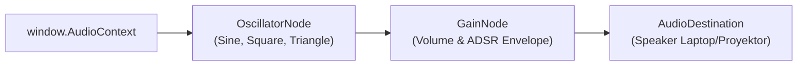
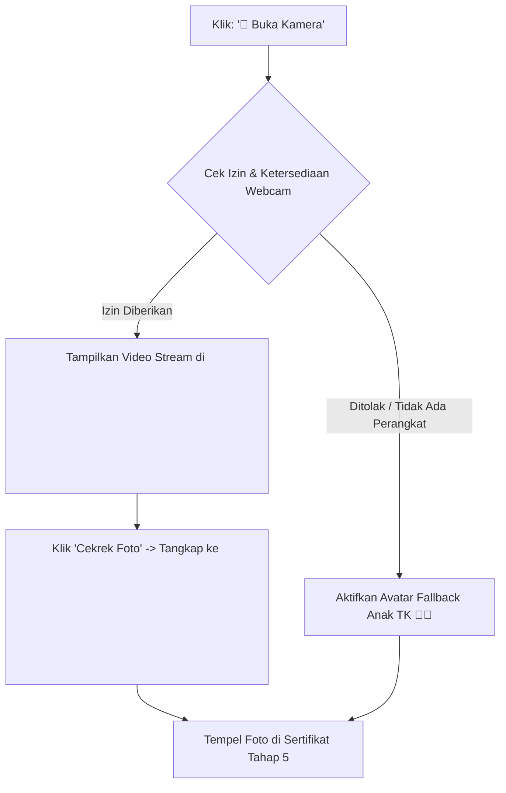

# Arsitektur Audio Synthesizer, Speech Engine, & Periferal
> **MISI CILIK: Selamatkan Taman Ceria!**  
> Spesifikasi teknis Web Audio API (SFX prosedural), Web Speech API (TTS Bahasa Indonesia), dan MediaDevices API (Kamera Aksi Nyata).

---

## 1. Web Audio API Procedural Synthesizer (Zero External MP3)

Salah satu titik kegagalan (*single point of failure*) terbesar dalam kompetisi aplikasi web luring (*offline*) adalah kegagalan pemuatan berkas audio eksternal (`404 Not Found` atau masalah *CORS / file:// protocol security*).

Untuk menjamin keandalan 100%, seluruh efek suara (SFX) dihasilkan secara prosedural menggunakan osilator bawaan peramban (**Web Audio API** - `window.AudioContext`):



### Spesifikasi Efek Suara (Procedural SFX Matrix):

| Jenis Suara | Kegunaan | Karakteristik Frekuensi & Durasi | Kode Prosedural |
| :--- | :--- | :--- | :--- |
| **Pop / Click** | Setiap tombol diklik | Nada pendek frekuensi tinggi menurun cepat (`800Hz` → `200Hz`, durasi `60ms`). | `osc.frequency.exponentialRampToValueAtTime(200, t + 0.06)` |
| **Chime / Ting** | Jawaban benar (pilah sampah / hitung) | Nada lonceng dua akor harmonis (`523.25Hz [C5]` lalu `659.25Hz [E5]`, `Sine wave`, decay lembut). | Arpeggio 2 nada berturut-turut berjarak `100ms`. |
| **Soft Buzzer** | Pilihan salah / kartu keliru | Nada rendah tumpul gelombang segitiga (`160Hz` turun ke `110Hz`, durasi `180ms`), tidak mengagetkan anak. | `type = 'triangle'`, fade-out halus agar ramah anak. |
| **Fanfare** | Misi Berhasil (Tahap 5) | Rangkaian nada kemenangan C-E-G-C tinggi bergantian cepat (`523Hz` → `659Hz` → `784Hz` → `1046Hz`) diiringi akor sustain. | 4 osilator sekuensial berjarak `120ms`. |
| **Applause** | Tepuk tangan saat anak berpendapat | White-noise generator dengan filter bandpass + modulasi gain cepat acak meniru tepuk tangan riuh. | Buffer noise terfilter frekuensi bicara manusia. |

---

## 2. Web Speech API (AI Text-to-Speech Bahasa Indonesia)

Untuk mendampingi anak-anak TK yang mayoritas belum lancar membaca tulisan, sistem menyediakan pembacaan teks otomatis menggunakan **Web Speech API** (`window.speechSynthesis`):

### Parameter Konfigurasi Suara Anak Lembut (Ibu Guru Diperkecil):
* **Basis Suara:** Suara perempuan alami Bahasa Indonesia (Gadis, Indah, Google Bahasa Indonesia, atau Zira) yang bebas dari resonansi pria dewasa.
* **Tinggi Nada (`pitch`):** `1.34` (sweet spot harmonis yang memperkecil suara Ibu Guru menjadi suara anak manis tanpa distorsi cempreng).
* **Laju Bicara (`rate`):** `0.94` (artikulasi lembut, santun, dan jelas didengar anak TK).
* **Preset Studio Suara AI:**
  * 🧒 **Ibu Guru Diperkecil:** `pitch: 1.34`, `rate: 0.94` (Default Pas & Lembut)
  * 👧 **Lebih Mungil:** `pitch: 1.42`, `rate: 0.96`
  * 👩 **Ibu Guru Asli:** `pitch: 1.15`, `rate: 0.90`
* **Studio Tuner:** Slider pitch (1.00 - 1.60x), slider rate (0.80 - 1.20x), dan dropdown pemilih suara browser langsung di Panel Juri.

### Strategi Pengelolaan Suara (Speech Queue Safety):
```javascript
function speakText(text, onEndCallback = null) {
  if (!('speechSynthesis' in window)) return;
  // Batalkan antrean ucapan sebelumnya agar tidak tumpang tindih
  window.speechSynthesis.cancel();

  const utterance = new SpeechSynthesisUtterance(text);
  utterance.lang = 'id-ID';
  utterance.rate = 0.9;
  utterance.pitch = 1.25;

  // Pilih suara Bahasa Indonesia terbaik jika tersedia dalam peramban
  const voices = window.speechSynthesis.getVoices();
  const idVoice = voices.find(v => v.lang.includes('id') || v.lang.includes('ID'));
  if (idVoice) utterance.voice = idVoice;

  if (onEndCallback) utterance.onend = onEndCallback;
  window.speechSynthesis.speak(utterance);
}
```

---

## 3. Integrasi Kamera Aksi Nyata (`getUserMedia`) & Fallback

Pada **Tahap 4 (Aksi Nyata)**, anak diajak menghubungkan pembelajaran digital ke dunia nyata dengan mengambil foto bukti aksi kelas.



### Penanganan Keamanan & Kegagalan Kamera (*Graceful Degradation*):
1. **Pemeriksaan API:** Sistem mengecek ketersediaan `navigator.mediaDevices && navigator.mediaDevices.getUserMedia`.
2. **Konteks Lokal (`file:///` vs `http`):** Sebagian browser membatasi webcam pada protokol `file:///`. Jika diblokir oleh kebijakan keamanan browser:
   * Aplikasi **tidak akan berhenti / macet**.
   * Sistem otomatis menampilkan pesan ramah: *"Mode Kamera Offline: Menggunakan Avatar Penyelamat Cilik"*.
   * Mengganti area foto dengan ilustrasi anak ceria memakai topi penyelamat lingkungan lengkap dengan nama anak.
3. **Penyimpanan Gambar Sesi:** Tangkapan kamera dikonversi menjadi data URL (`canvas.toDataURL('image/png')`) di dalam memori sesi (tanpa perlu diunggah ke server mana pun), siap dicetak langsung di lembar sertifikat Tahap 5.
