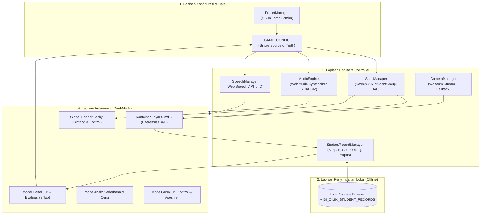
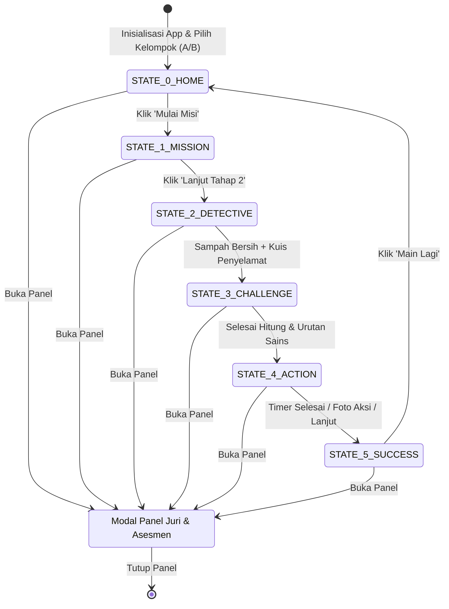

# Arsitektur Sistem & Aliran Data Aplikasi
> **MISI CILIK: Selamatkan Lingkungan!**  
> Desain komponen perangkat lunak, mesin status (Finite State Machine), arsitektur antarmuka Dual-Mode, dan asesmen berbasis bukti observasi.

---

## 1. Ikhtisar Arsitektur Aplikasi

Aplikasi dibangun dengan arsitektur **Single-Page Application (SPA) Monolitik Berkas Tunggal** (*Single-File Architecture*) berbasis *Offline-First*. Pola ini memberikan performa stabil, latensi jaringan nol, dan kebebasan dari kegagalan teknis saat dipresentasikan di hadapan dewan juri atau digunakan bersama anak di kelas.



---

## 2. Arsitektur Dual-Mode Antarmuka (Mode Anak vs Mode Guru)

Untuk menciptakan pengalaman yang optimal bagi anak dan kenyamanan bagi guru/peserta lomba:

```
┌─────────────────────────────────────────────────────────────────┐
│                      APLIKASI MISI CILIK                        │
├────────────────────────────────┬────────────────────────────────┤
│       🧒 MODE ANAK (PLAY)      │    👩‍🏫 MODE GURU / JURI (PRO)   │
├────────────────────────────────┼────────────────────────────────┤
│ • Layar permainan bersih       │ • Panel Juri multi-tab         │
│ • Tombol raksasa membulat      │ • Live Theme Switcher 4 tema   │
│ • Instruksi audio interaktif   │ • Asesmen observasi (BB-BSB)   │
│ • Zero distraksi teks teknis   │ • Rekap data murid & sertifikat│
│ • Penguatan positif tanpa kalah│ • Panduan kurikulum & SOP lomba│
└────────────────────────────────┴────────────────────────────────┘
```

1. **Mode Anak Aktif Secara Default di Panggung Permainan:**
   * Anak hanya melihat kanvas permainan, tombol aksi besar, animasi kartun, dan narasi suara.
   * Parameter teknis (seperti JSON editor atau SOP dewan juri) tidak tampil di layar permainan.
2. **Mode Guru / Juri Terbuka Melalui Kontrol Header:**
   * Guru dapat membuka panel kontrol kapan saja melalui tombol `📋 Panel Juri` di header atas.
   * Tidak menghentikan atau merusak progres permainan anak.

---

## 3. Mesin Status Tampilan (Finite State Machine)

Aplikasi mengelola 6 status layar utama yang diaktifkan secara deterministik menggunakan manipulasi visibilitas DOM:



### Rincian Perilaku State:
* `STATE_0_HOME`: Layar awal, input identitas murid, selektor `studentGroup` (`'A'` vs `'B'`), pemutar video animasi AI sub-tema aktif, dan tombol mulai raksasa.
* `STATE_1_MISSION`: Animasi skenario kotor, tombol TTS narasi, pertanyaan pemantik guru (konkret untuk A, analitis sebab-akibat untuk B), dan tombol navigasi kembali `⬅`.
* `STATE_2_DETECTIVE`: Game pilah sampah 2-klik:
  * **Kelompok A:** Memilah **4 item sampah konkret** (2 organik vs 2 anorganik).
  * **Kelompok B:** Memilah **6 item sampah lengkap** disertai badge alasan ilmiah sebab-akibat.
  * Sub-kuis alat bantu penyelamatan lingkungan & tombol kembali `⬅`.
* `STATE_3_CHALLENGE`: 
  * Sub-state 3A: Membilang objek spesifik tema (bunga matahari / bintang laut / hewan / alat sekolah) **tanpa bocoran angka** (1–5 untuk A, 1–10 untuk B) dengan suara verbal TTS per sentuhan.
  * Sub-state 3B: Mengurutkan 4 kartu siklus alami (bernomor untuk A, mandiri tanpa nomor untuk B + narasi sains komprehensif saat tuntas).
* `STATE_4_ACTION`: Timer 60 detik aksi gotong royong (2 checklist untuk A, 3 checklist untuk B), serta cermin video webcam dengan tombol jepret foto (izin eksplisit pengguna) & safe fallback.
* `STATE_5_SUCCESS`: Selebrasi kemenangan, hujan confetti, sertifikat berfoto dengan badge kelompok usia, lembar asesmen autentik interaktif berbasis bukti observasi guru (pilihan skala BB, MB, BSH, BSB), dan pencatatan ke `Local Storage`.

---

## 4. Aliran Asesmen Autentik Berbasis Bukti Pengamatan (Evidence-Based Assessment)

```
[Anak Bermain di Tahap 1 s/d 4] ──► [Guru Mengamati Respon, Pemilahan, & Aksi Nyata]
                                                    │
                                                    ▼
                                   [Tahap 5: Lembar Asesmen Interaktif]
                                   [Guru Memilih Skala BB / MB / BSH / BSB]
                                                    │
                                                    ▼
                                   [Penyimpanan Otomatis ke Local Storage]
                                                    │
                                 ┌──────────────────┴──────────────────┐
                                 ▼                                     ▼
                    [Sertifikat Cetak Murid]            [Tabel Rekap Portofolio Kelas]
```

1. **Interaksi Guru di Lembar Asesmen:**
   * Di Tahap 5, disediakan tabel 6 aspek perkembangan.
   * Guru mengklik predikat capaian (BB, MB, BSH, BSB) pada setiap indikator sesuai bukti perilaku yang diamati.
   * Deskripsi indikator otomatis menyesuaikan kelompok usia (`Kelompok A` vs `Kelompok B`).
2. **Penyimpanan Lokal:**
   * Kunci penyimpanan: `MISI_CILIK_STUDENT_RECORDS`.
   * Struktur data mencakup: ID unik, nama murid, kelompok (A/B), sub-tema, 5 bintang, nilai rubrik 6 aspek pilihan guru, timestamp, dan foto aksi Base64.
3. **Manajemen Portofolio (Panel Juri Tab 3):**
   * Menampilkan daftar murid lengkap.
   * Tombol cetak ulang sertifikat per anak.
   * Tombol hapus data riwayat.

---

## 5. Aliran Peristiwa (Event Handling Lifecycle)

```
[Aksi Sentuh Anak / Guru]
          │
          ▼
[Umpan Balik Instan: SFX Prosedural Web Audio (<10ms) & CSS Keyframe]
          │
          ▼
[Pemeriksaan Aturan: Kelompok A (4 item/1-5) vs B (6 item/1-10)]
          │
          ├── Jika Benar ──► [Tambah Bintang ⭐ + Partikel + TTS Validasi]
          │
          └── Jika Salah ──► [Getar Lembut + TTS Bimbingan Ramah]
          │
          ▼
[Pembaruan State / Transisi Layar / Pengisian Asesmen Guru di Tahap 5]
```
