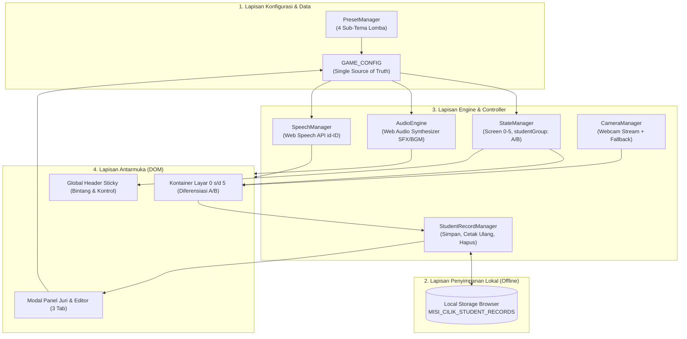

# Arsitektur Sistem & Aliran Data Aplikasi
> **MISI CILIK: Selamatkan Lingkungan!**  
> Desain komponen perangkat lunak, mesin status (Finite State Machine), arsitektur penyimpanan lokal (Local Storage), dan alur diferensiasi Kelompok A & B.

---

## 1. Ikhtisar Arsitektur Aplikasi

Aplikasi dibangun dengan arsitektur **Single-Page Application (SPA) Monolitik Berkas Tunggal** (*Single-File Architecture*) berbasis *Offline-First*. Pola ini memberikan performa andal, nol latensi jaringan, dan jaminan bebas kegagalan teknis saat dipresentasikan di hadapan dewan juri atau digunakan di kelas.



---

## 2. Mesin Status Tampilan (Finite State Machine)

Aplikasi mengelola 6 status layar utama yang diaktifkan secara deterministik menggunakan pengalihan visibilitas DOM:


### Rincian Perilaku State:
* `STATE_0_HOME`: Layar awal, input identitas murid, selektor `studentGroup` (`'A'` vs `'B'`), pemutar video sub-tema aktif, dan tombol mulai.
* `STATE_1_MISSION`: Animasi pengantar masalah lingkungan, tombol TTS pemantik narasi, dan daftar pertanyaan diskusi guru (otomatis memuat `pertanyaanA` atau `pertanyaanB`).
* `STATE_2_DETECTIVE`: Game pilah 6 sampah (organik vs anorganik) dengan sistem dual-input 2-klik. Khusus Kelompok B, kartu sampah memunculkan badge alasan ilmiah edukatif. Sub-kuis alat penyiram tanaman.
* `STATE_3_CHALLENGE`: 
  * Sub-state 3A: Membilang bunga mekar (1–5 untuk Kelompok A, 1–10 untuk Kelompok B) dengan suara verbal TTS per sentuhan.
  * Sub-state 3B: Mengurutkan 4 kartu siklus perkembangan (bernomor untuk A, mandiri tanpa nomor untuk B + narasi sains sebab-akibat saat selesai).
* `STATE_4_ACTION`: Timer 60 detik aksi gotong royong (2 checklist untuk A, 3 checklist untuk B), serta cermin video webcam dengan fallback aman.
* `STATE_5_SUCCESS`: Selebrasi kemenangan, hujan confetti, sertifikat berfoto dengan badge kelompok usia, lembar observasi guru dengan indikator dinamis, dan pencatatan otomatis ke `Local Storage`.

---

## 3. Komponen Global (Persistent Header)

Header ini tetap terpancang di bagian atas (*sticky*) sepanjang permainan:

```
+-----------------------------------------------------------------------------------------+
| [🐝 Misi Cilik] [Tahap 2/5] [🐥 Kel. A] |  [ ⭐⭐⭐☆☆ (3/5) ]  |  [🔊 Suara] [🎵 Musik] [📋 Juri] |
+-----------------------------------------------------------------------------------------+
```

1. **Bagian Kiri (Navigasi & Indikator Kelompok):**
   * Nama Game & Ikon Maskot Aktif.
   * *Pill badge* status tahap saat ini (misal: "Tahap 2 dari 5: Detektif Sampah").
   * *Pill badge* kelompok usia aktif (`🐥 Kelompok A` atau `🦉 Kelompok B`).
2. **Bagian Tengah (Penghitung Bintang Emas):**
   * 5 bintang emas interaktif dengan efek CSS *bounce* saat bertambah.
3. **Bagian Kanan (Panel Kendali Guru):**
   * **Tombol Suara TTS (`🔊`):** Toggle narasi suara pemandu.
   * **Tombol Musik Latar (`🎵`):** Toggle audio instrumen ceria.
   * **Tombol Panel Juri & Editor (`📋`):** Membuka modal multi-tab (Panduan Lomba, Pengubah Sub-Tema, dan Rekapitulasi Data Murid).

---

## 4. Subsistem Penyimpanan Lokal (Local Storage Engine)

Aplikasi menyertakan mesin pencatatan portofolio anak di sisi peramban tanpa memerlukan server eksternal:

### Skema Data:
Kunci penyimpanan: `MISI_CILIK_STUDENT_RECORDS` (Array of Object berformat JSON)

```javascript
[
  {
    "id": 1729501234567,
    "name": "Arkan",
    "group": "A",
    "theme": "SELAMATKAN TAMAN CERIA!",
    "stars": 5,
    "rubric": {
      "nam": "BSB",
      "kognitif": "BSB",
      "bahasa": "BSH",
      "numerasi": "BSB",
      "motorik": "BSH",
      "sosek": "BSB"
    },
    "date": "21/10/2026, 10.30 WIB",
    "photo": "data:image/jpeg;base64,..."
  }
]
```

### Kapabilitas Tab 3 Panel Juri ("📊 Data Hasil Murid"):
1. **Daftar Portofolio Kelas:** Menampilkan tabel seluruh anak yang telah menyelesaikan misi, lengkap dengan tanggal, kelompok usia, sub-tema, dan perolehan bintang.
2. **Cetak Ulang Sertifikat (`Reprint`):** Guru dapat mencetak kembali sertifikat kelulusan anak tertentu kapan saja.
3. **Penghapusan Catatan (`Delete`):** Guru dapat menghapus data tertentu jika diperlukan (misal: saat menguji coba permainan).

---

## 5. Aliran Peristiwa (Event Handling Lifecycle)

```
[Aksi Sentuh Anak / Guru]
          │
          ▼
[Umpan Balik Instan: SFX Prosedural Web Audio (<10ms) & CSS Keyframe]
          │
          ▼
[Pemeriksaan Aturan: Sesuai Kelompok A atau B & Kategori GAME_CONFIG]
          │
          ├── Jika Benar ──► [Tambah Bintang ⭐ + Partikel + TTS Validasi]
          │
          └── Jika Salah ──► [Getar Tong / Kartu + TTS Bimbingan Ramah]
          │
          ▼
[Pembaruan State / Transisi Layar / Penyimpanan Local Storage di Tahap 5]
```
