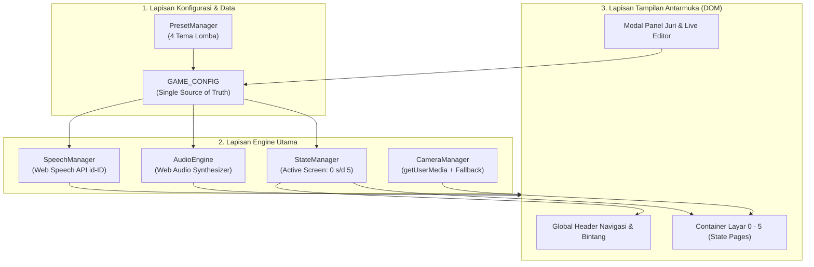
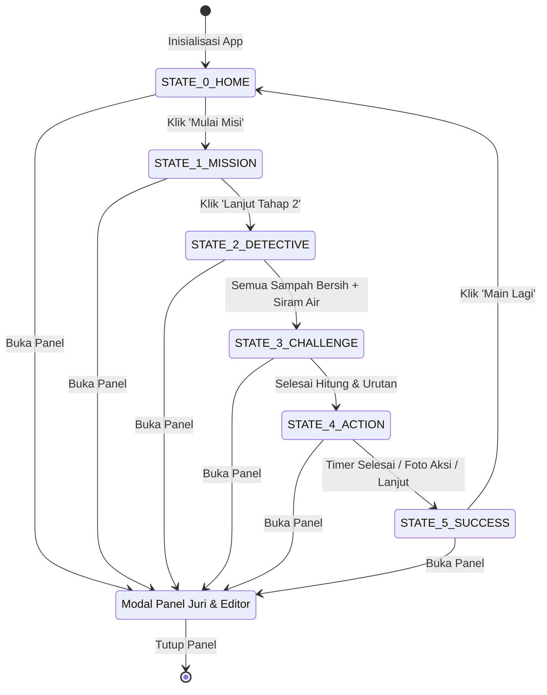

# Arsitektur Sistem & Aliran Data Aplikasi
> **MISI CILIK: Selamatkan Taman Ceria!**  
> Desain komponen perangkat lunak, mesin state (Finite State Machine), dan alur data aplikasi.

---

## 1. Ikhtisar Arsitektur Aplikasi

Aplikasi dibangun dengan pola **Single-Page Application (SPA) Monolitik Berkas Tunggal** (*Single-File Architecture*). Pola ini dipilih secara sengaja untuk memenuhi syarat keandalan tinggi pada kompetisi: **zero setup**, **zero build step**, dan **offline-first**.



---

## 2. Mesin Status Tampilan (Finite State Machine)

Aplikasi memiliki 6 state layar utama yang diaktifkan secara eksklusif menggunakan manipulasi kelas CSS `hidden` atau penyesuaian kontainer dinamis:



### Definisi Status (Screen States):
* `STATE_0_HOME`: Layar pembuka, judul besar, tombol mulai raksasa, akses cepat ganti tema.
* `STATE_1_MISSION`: Animasi taman kotor, tombol pemantik audio narasi, panel pertanyaan diskusi guru.
* `STATE_2_DETECTIVE`: Permainan pilah 6 sampah (organik vs anorganik) + sub-kuis memilih alat siram tanaman.
* `STATE_3_CHALLENGE`: 
  * Sub-state 3A: Membilang 5 bunga matahari mekar.
  * Sub-state 3B: Mengurutkan 4 kartu siklus tanaman.
* `STATE_4_ACTION`: Timer 60 detik aksi nyata, checklist gotong royong, dan video kamera langsung (*live webcam stream*).
* `STATE_5_SUCCESS`: Selebrasi kemenangan, confetti visual, transisi before-after taman, sertifikat digital berfoto, dan lembar evaluasi cetak.

---

## 3. Komponen Global (Global Header & Controls)

Komponen ini selalu berada di bagian atas layar (*sticky / persistent header*), terlepas dari state layar yang aktif:

```
+-----------------------------------------------------------------------------------+
| [🐝 Misi Cilik] [Tahap 2/5]   |   [ ⭐⭐⭐☆☆ (3/5) ]   |   [🔊 Suara] [🎵 Musik] [📋 Juri] |
+-----------------------------------------------------------------------------------+
```

1. **Bagian Kiri (Indikator Status Permainan):**
   * Nama Game & Ikon Maskot Aktif.
   * *Pill badge* penanda posisi tahap (misal: "Tahap 2 dari 5: Misi Detektif").
2. **Bagian Tengah (Penghitung Bintang Anak):**
   * Menampilkan representasi visual 5 bintang emas (`⭐`).
   * Setiap penambahan bintang memicu animasi CSS *bounce/jump* dan partikel melayang.
3. **Bagian Kanan (Panel Kendali Cepat):**
   * **Tombol Suara Narasi (`🔊`):** Toggle on/off fungsi Text-to-Speech (TTS).
   * **Tombol Musik Latar (`🎵`):** Toggle on/off audio BGM ceria.
   * **Tombol Panel Juri & Editor (`📋`):** Membuka modal pengaturan kurikulum dan pengubah tema instan.

---

## 4. Aliran Peristiwa (Event Handling Lifecycle)

Setiap aksi pengguna diproses secara deterministik:

1. **Aksi Klik Pengguna (User Action):**
   * Pengguna mengklik atau menyentuh tombol/elemen permainan.
2. **Umpan Balik Instan (Audio-Visual Feedback):**
   * `AudioEngine.playPop()` atau SFX terkait langsung dieksekusi (<10ms).
   * Elemen mendapatkan kelas CSS animasi aktif (`scale-95`, `ring-4`).
3. **Pemeriksaan Logika Bisnis (Game Rule Evaluation):**
   * Memeriksa apakah pilihan cocok dengan target kategori dalam `GAME_CONFIG`.
4. **Pembaruan State & Tampilan (DOM Re-render):**
   * Jika benar: Tambah bintang, jalankan animasi sukses, ubah state jika target tercapai.
   * Jika salah: Jalankan animasi getar (*shake*), berikan dialog saran suara.
5. **Pemicu Narasi Suara (TTS Speech Cue):**
   * `SpeechManager.speak(teks)` dipanggil untuk memperkuat umpan balik belajar anak.
