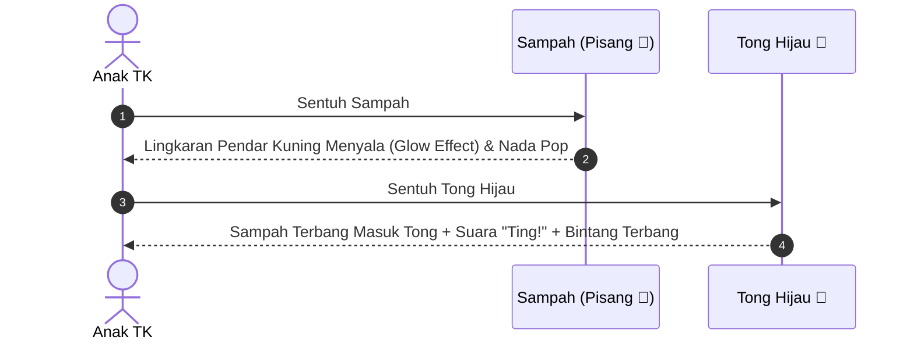

# Standar Desain Antarmuka & Pengalaman Pengguna Anak TK (UI/UX Standards)
> **MISI CILIK: Selamatkan Taman Ceria!**  
> Karakteristik psikologi anak usia 4–6 tahun, ergonomi sentuh, palet warna, dan animasi interaktif.

---

## 1. Karakteristik Pengguna Sasaran (Usia 4–6 Tahun)

Anak usia Taman Kanak-Kanak (Kelompok A dan B) memiliki karakteristik interaksi digital yang khas:

```
┌──────────────────────────────────────────────────────────────┐
│  1. Belum lancar membaca teks panjang (Orientasi Ikon/Suara)  │
│  2. Kemampuan motorik halus masih berkembang (Butuh tombol   │
│     ekstra besar dan target sentuh lapang)                   │
│  3. Rentang perhatian singkat (Butuh umpan balik visual      │
│     dan suara langsung dalam < 0.2 detik)                    │
│  4. Membutuhkan penguatan positif (Tidak boleh membuat rasa   │
│     takut/frustrasi saat membuat kesalahan)                  │
└──────────────────────────────────────────────────────────────┘
```

---

## 2. Standar Tombol & Ukuran Area Sentuh (Touch Targets)

* **Dimensi Minimal Tombol Interaktif:**
  * Tombol navigasi utama: Minimal tinggi `72px` (kelas Tailwind: `py-4 px-8` hingga `py-6 px-12`).
  * Item kartu/sampah: Minimal `96px x 96px` (kelas: `w-24 h-24` hingga `w-28 h-28`).
  * Tong sampah target: Minimal `160px x 180px` agar mudah dijangkau dari jarak jauh proyektor.
* **Bentuk Sudut (*Border Radius*):**
  * Seluruh tombol, kontainer kartu, dan modal wajib menggunakan sudut membulat lebar (`rounded-2xl`, `rounded-3xl`, atau `rounded-full`). Hindari sudut tajam (`sharp corners`).
* **Tata Letak Navigasi Bersanding (Dual Navigation Action):**
  * Di setiap tahap interaktif (Tahap 1–4), tombol `⬅ Kembali` disandingkan harmonis dengan tombol `Lanjut ➔` menggunakan kontainer responsif (`flex flex-col sm:flex-row gap-3`).
* **Efek Penekanan (*Tactile Feedback*):**
  * Setiap tombol harus memiliki efek visual saat disentuh: `active:scale-95 transition-transform duration-150` disertai bayangan timbul tebal (`shadow-lg hover:shadow-xl border-b-4 border-emerald-600 active:border-b-0 active:translate-y-1`).

---

## 3. Sistem Dual-Input (Ramah Layar Sentuh & Proyektor Kelas)

Di banyak ruang kelas TK atau panggung lomba, media diproyeksikan menggunakan proyektor dinding atau layar sentuh (*touchscreen* monitor). Menyeret (*drag-and-drop*) di layar proyektor sering kali macet atau terlepas di tengah jalan karena jari anak licin/kering.

Oleh karena itu, aplikasi wajib menerapkan **Sistem 2-Klik (Click-to-Select, Click-to-Drop)**:



*Jika pengguna menggunakan mouse komputer standar, mekanisme seret-lepas (*Drag-and-Drop*) tetap aktif sebagai opsi alternatif.*

---

## 4. Palet Warna Ramah Anak (Color Palette)

Gunakan kombinasi warna cerah, kontras tinggi, dan ramah mata anak:

| Peran Warna | Hex / Tailwind Class | Makna Emosional |
| :--- | :--- | :--- |
| **Latar Belakang Langit** | `from-sky-200 to-sky-100` | Ketenangan, keceriaan, suasana luar ruangan. |
| **Rumput & Alam (Organik)** | `bg-emerald-500 hover:bg-emerald-600` | Kesegaran, kebersihan alam, ramah lingkungan. |
| **Peringatan & Anorganik** | `bg-amber-400 hover:bg-amber-500` | Kehangatan, waspada, menarik perhatian. |
| **Apresiasi & Bintang** | `text-yellow-400 fill-yellow-400` | Prestasi, kemilau emas, kebahagiaan. |
| **Navigasi Mundur (Kembali)** | `bg-slate-200 hover:bg-slate-300 text-slate-700` (`.btn-cartoon-slate`) | Netral, tenang, tidak mengaburkan fokus tombol aksi utama. |
| **Aksi & Tombol Utama** | `bg-rose-500 hover:bg-rose-600` | Semangat, urgensi aksi penyelamatan. |

---

## 5. Standar Animasi CSS Keyframes

Seluruh animasi menggunakan CSS murni berbasis *transform* dan *opacity* untuk menjaga performa rendering tetap 60 FPS pada laptop sekolah spesifikasi standar:

```css
/* 1. Karakter Maskot Melayang Lembut */
@keyframes float {
  0%, 100% { transform: translateY(0px) rotate(0deg); }
  50% { transform: translateY(-12px) rotate(2deg); }
}
.animate-float {
  animation: float 3s ease-in-out infinite;
}

/* 2. Goyang Ceria (Wiggle) pada Bunga & Bintang */
@keyframes wiggle {
  0%, 100% { transform: rotate(-4deg); }
  50% { transform: rotate(4deg); }
}
.animate-wiggle {
  animation: wiggle 1s ease-in-out infinite;
}

/* 3. Getar Peringatan Lembut saat Pilihan Keliru (Shake) */
@keyframes soft-shake {
  0%, 100% { transform: translateX(0); }
  20%, 60% { transform: translateX(-8px); }
  40%, 80% { transform: translateX(8px); }
}
.animate-soft-shake {
  animation: soft-shake 0.4s ease-in-out;
}

/* 4. Berdenyut Menarik Perhatian pada Tombol Mulai (Pulse Glow) */
@keyframes pulse-glow {
  0%, 100% { transform: scale(1); filter: drop-shadow(0 0 10px rgba(16, 185, 129, 0.4)); }
  50% { transform: scale(1.05); filter: drop-shadow(0 0 25px rgba(16, 185, 129, 0.8)); }
}
.animate-pulse-glow {
  animation: pulse-glow 2s infinite ease-in-out;
}
```

---

## 6. Filosofi Penguatan Positif (Zero Punishment Policy)

1. **Tidak Ada Status *Game Over*:** Anak tidak boleh mengalami layar kekalahan merah menyala yang menakutkan atau skor minus.
2. **Koreksi Konstruktif:** Jika anak salah memasukkan sampah ke tong yang keliru:
   * Tong hanya bergoyang pelan dengan suara *tetot* tumpul lembut.
   * Sampah kembali ke posisinya dengan aman.
   * Suara Ara memberikan dorongan: *"Ups, coba perhatikan lagi ya! Benda ini terbuat dari apa?"*.
3. **Pujian Multi-Sensori:** Setiap keberhasilan selalu dirayakan dengan kombinasi visual (bintang terbang / warna emas), auditori (suara *ting!* harmonis), dan verbal (suara TTS apresiatif).
